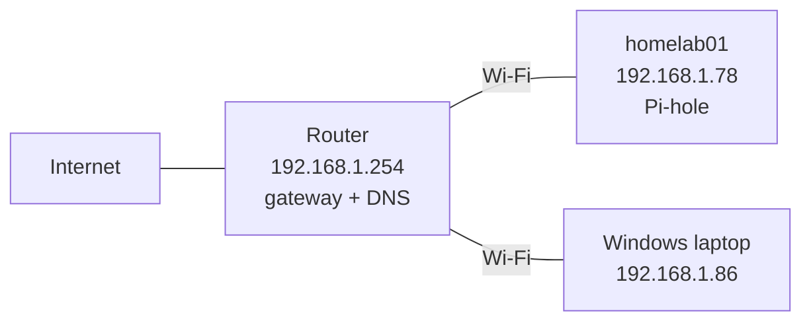

# 01 - Network Discovery & Documentation

## Goal

Map my network and see how DHCP, ARP, and DNS actually work at the packet level, then break things on purpose and document how I found and fixed each problem.

## Scope

homelab01 is on a shared Wi-Fi network that belongs to my landlord. I limited this project to my own devices: no network scanning, no router admin access, and no details about other people's devices.

## Setup

- **homelab01:** Dell OptiPlex 5060, Ubuntu, Wi-Fi interface `wlp2s0`, running Pi-hole
- **Laptop:** Windows, connects to homelab01 over SSH
- **Method:** capture with `tcpdump` on homelab01, copy the file to the laptop with `scp`, analyze in Wireshark

## Network map



| Device | IP | Role |
|---|---|---|
| Router | 192.168.1.254 | Default gateway, DHCP server, DNS for homelab01 |
| homelab01 | 192.168.1.78/24 | Ubuntu server, Pi-hole DNS for the laptop |
| Windows laptop | 192.168.1.86 | SSH client, Wireshark |

- Network: `192.168.1.0/24` (broadcast address `192.168.1.255`)
- All addresses are assigned by DHCP from the router

## What I observed

### DHCP

Triggered a renewal with `networkctl reconfigure wlp2s0` while capturing on ports 67 and 68. Captured 5 packets:

| # | From -> To | Type | Meaning |
|---|---|---|---|
| 1 | homelab01 -> router | Release | Gave up its old IP |
| 2 | 0.0.0.0 -> 255.255.255.255 | Discover | Looking for any DHCP server |
| 3 | router -> homelab01 | Offer | Offered 192.168.1.78 |
| 4 | 0.0.0.0 -> 255.255.255.255 | Request | Accepted the offer |
| 5 | router -> homelab01 | Ack | Confirmed, with subnet mask, router, DNS server, and lease time |

<!--  -->

- **Why 0.0.0.0:** the client had just released its IP, so it had no address to send from.
- **Why 255.255.255.255:** the client doesn't know where the DHCP server is, so it broadcasts to everyone on the local network. The Request is also broadcast so any other DHCP server knows which offer was accepted.
- The settings in the Ack matched what `ip a`, `ip route`, and `resolvectl status` showed, which confirms those settings come from DHCP.
- homelab01's IP changed from `.67` to `.78` between sessions. Without a DHCP reservation, the address isn't guaranteed to stay the same.

### ARP

Cleared the neighbor table with `ip neigh flush all`, then pinged the router while capturing ARP. Captured 6 packets:

| # | Who | Message |
|---|---|---|
| 1 | homelab01 (broadcast) | Who has 192.168.1.254? Tell 192.168.1.78 |
| 2 | homelab01 (broadcast) | Who has 192.168.1.86 (laptop)? Tell 192.168.1.78 |
| 3 | Laptop -> homelab01 | 192.168.1.86 is at (laptop MAC) |
| 4 | Router -> homelab01 | 192.168.1.254 is at (router MAC) |
| 5 | Router | Who has 192.168.1.78? |
| 6 | homelab01 -> router | 192.168.1.78 is at (homelab01 MAC) |

<!--  -->

- Requests are broadcast because homelab01 doesn't know which device has that IP. Replies go straight back to whoever asked.
- Flushing the table also wiped the laptop's entry, so homelab01 had to look it up again to keep the SSH session going (packets 2 and 3).
- The router checked homelab01's MAC in return (packets 5 and 6).
- `ip neigh` shows each entry's state: **REACHABLE** (recently confirmed), **STALE** (cached but not recently confirmed), **DELAY** (about to be re-checked).

### DNS

I captured two different DNS paths.

**homelab01's own lookups go to the router:**

```
homelab01 --(query: github.com)--> router 192.168.1.254
homelab01 <--(answer: IPv4 addresses)-- router
```

`dig github.com` returned several A records. `resolvectl status` shows `192.168.1.254` as the DNS server for `wlp2s0`.

**The laptop's lookups go through Pi-hole on homelab01:**

```
laptop --> Pi-hole (homelab01) --> Cloudflare (1.1.1.1 / 1.0.0.1)
laptop <-- Pi-hole (homelab01) <-- Cloudflare
```

Example: the laptop asked for `v20.events.data.microsoft.com`. Pi-hole forwarded the query upstream to Cloudflare, got the answer, and passed it back to the laptop.

- DNS uses port 53.
- Pi-hole acts as a middleman: it answers the laptop and does the outside lookup itself. That's also where blocking and logging happen.

<!--  -->

## Troubleshooting log

### Issue 0: `apt update` failed (unplanned)

- **Symptom:** `apt update` errors said the release files were "not valid yet."
- **Diagnosis:** `timedatectl` showed the system clock was hours behind. The files looked like they came from the future.
- **Root cause:** the system clock wasn't synchronized.
- **Fix:** set the time and time zone manually with `timedatectl set-time` and `timedatectl set-timezone America/Toronto`.
- **Verified:** `apt update` completed without errors.
- **Follow-up:** confirm NTP is enabled (`timedatectl set-ntp true`) so the clock doesn't drift again.

### Issue 1: DHCP capture got 0 packets

- **Symptom:** tcpdump finished with 0 packets captured.
- **Diagnosis:** the output showed the capture ended before the renewal command ran.
- **Root cause:** a timing problem with the test, not the tool.
- **Fix:** started the capture and the renewal in one command (`tcpdump ... & sleep 3; networkctl reconfigure wlp2s0`).
- **Verified:** captured 5 DHCP packets.

### Observation: can't ping the laptop

- Pinging the laptop from homelab01 fails because Windows Firewall blocks incoming ping (ICMP echo) by default.
- The laptop is still reachable. SSH from the laptop works, and ARP shows it on the network.
- Lesson: a failed ping doesn't always mean a device is down.

### Planned breaks

- [ ] Wrong DNS server (`resolvectl dns wlp2s0 10.9.9.9`)
- [ ] Wrong default gateway

## What I learned

- Every device gets its IP, mask, gateway, and DNS from DHCP, and I can see that handoff happen in four packets.
- Devices on the same network talk using MAC addresses, so ARP has to run before almost anything else.
- DNS can pass through several hops (laptop to Pi-hole to Cloudflare) before an answer comes back.
- Checking the timing of a test is as important as checking the tool.

## Useful commands

| Command | Device | What it does |
|---|---|---|
| `hostname -I` | homelab01 | Show IP addresses |
| `ip a` | homelab01 | Interfaces, IPs, MACs |
| `ip route` | homelab01 | Default gateway |
| `resolvectl status` | homelab01 | DNS server per interface |
| `ip neigh` | homelab01 | ARP / neighbor table |
| `dig <name>` | homelab01 | DNS lookup |
| `tcpdump -i wlp2s0 -w file.pcap <filter>` | homelab01 | Capture packets to a file |
| `scp user@host:~/file.pcap .` | Laptop | Copy a capture to the laptop |
| `ipconfig /all` | Laptop | Laptop network settings |
| `arp -a` | Laptop | Laptop ARP table |

## Next

- Run the two planned breaks
- Add Wireshark screenshots (MACs hidden)