# Project 1 - Network Discovery & Documentation
 
## Overview
 
This project focused on learning the fundamentals of Linux networking by inspecting a live network from an Ubuntu homelab connected over Wi-Fi.
 
The goal was to understand how the machine gets its network settings, how it finds other devices on the local network, how DNS lookups travel, and how to build a troubleshooting workflow using command-line tools and packet captures.
 
---
 
## Scope
 
The homelab is on a shared Wi-Fi network that belongs to my landlord. I limited this project to my own devices: no scanning of other devices, no router admin access, and no details about other people's devices.
 
---
 
## Environment
 
| Item | Value |
|---|---|
| Homelab | `homelab01`, Dell OptiPlex 5060, Ubuntu Linux |
| Connection type | Wi-Fi |
| Primary interface | `wlp2s0` |
| Homelab IP during testing | `192.168.1.78/24` |
| Laptop | Windows, `192.168.1.86`, used for SSH and Wireshark |
| Default gateway | `192.168.1.254` |
| Local subnet | `192.168.1.0/24` |
| Broadcast address | `192.168.1.255` |
| DNS server provided by the network | `192.168.1.254` |
| Extra service | Pi-hole running on homelab01 (DNS for my laptop + phone) |
 
**Workflow:** capture packets with `tcpdump` on homelab01, copy the file to the laptop with `scp`, and analyze it in Wireshark.
 
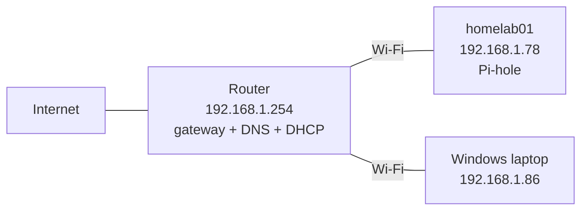
 
> Note: the IP addresses shown are private (RFC 1918) addresses. MAC addresses have been replaced or hidden.
 
---
 
## 1. Identifying the Homelab IP Address
 
### Commands
 
```bash
hostname -I
```
 
```bash
ip -4 addr show wlp2s0
```
 
### What was learned
 
The homelab received its address dynamically through DHCP:
 
```text
192.168.1.78/24
```
 
The `/24` prefix means the first three numbers identify the network and the last number identifies the device, so the local subnet is:
 
```text
192.168.1.0/24
```
 
The address changed from `192.168.1.67` in the first session to `192.168.1.78` after a DHCP renewal. Without a DHCP reservation, the address is not guaranteed to stay the same.
 
**Screenshot 1**
 
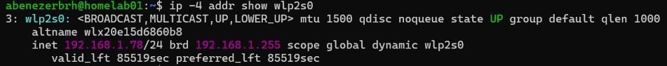
 
---
 
## 2. Inspecting the Routing Table
 
### Command
 
```bash
ip route
```
 
### Observed Output
 
```text
default via 192.168.1.254 dev wlp2s0
192.168.1.0/24 dev wlp2s0
```
 
### What was learned
 
The default gateway is `192.168.1.254`. This is where the homelab sends traffic when the destination is outside the local subnet.
 
The second line confirms that traffic for `192.168.1.0/24` stays on the local Wi-Fi interface and does not go through the gateway.
 
**Screenshot 2**
 
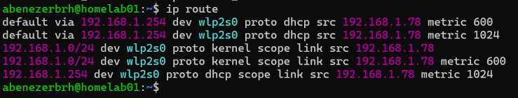
 
---
 
## 3. Understanding DNS Configuration
 
### Commands
 
```bash
resolvectl status
```
 
```bash
dig google.com
```
 
### Observations
 
- `resolvectl status` showed `192.168.1.254` as the DNS server for `wlp2s0`.
- `dig google.com` returned several IPv4 addresses.
- `dig google.com` returned six IPv4 addresses, and the server that answered was `192.168.1.254#53` (the router).
### What was learned
 
homelab01 sends its DNS questions straight to the router on port 53:
 
```text
Application (dig)
   |
   v
192.168.1.254:53  (router, DNS server)
```
 
On a default Ubuntu install, `dig` usually shows `127.0.0.53`, a local helper called `systemd-resolved` that forwards queries for you. Here it goes straight to the router instead, most likely because Pi-hole runs on this machine and needs port 53 for itself, so the local helper is turned off.
 
**Screenshot 3**
 
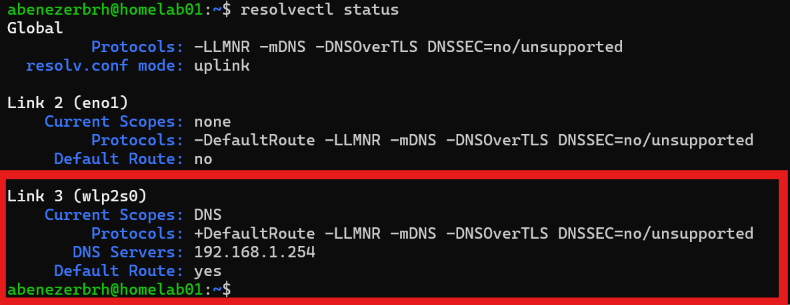
 
**Screenshot 4**
 
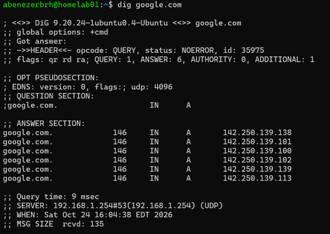
 
---
 
## 4. Installing Networking Tools
 
### Commands
 
```bash
sudo apt update
```
 
```bash
sudo apt install tcpdump dnsutils nmap
```
 
### What was learned
 
- `tcpdump` captures packets from the command line
- `dnsutils` provides `dig` and `nslookup`
- `nmap` scans hosts and services
- Wireshark (on the laptop) is used to read the captures in detail

---
 
## 5. Viewing the Neighbor Table
 
### Command
 
```bash
ip neigh
```
 
### Example Observations
 
```text
192.168.1.86 dev wlp2s0 lladdr aa:bb:cc:00:00:01 STALE
192.168.1.254 dev wlp2s0 lladdr aa:bb:cc:00:00:02 DELAY
```
 
### What was learned
 
`ip neigh` shows the neighbor (ARP) table, which maps:
 
```text
IP address -> MAC address
```
 
It is the Linux replacement for the older `arp -a` command.
 
The state describes how recently Linux confirmed the device:
 
- **REACHABLE:** recently confirmed
- **STALE:** cached, but not confirmed recently
- **DELAY:** about to be checked again

**Screenshot 5**
 

 
---
 
## 6. Capturing DHCP
 
### Commands
 
```bash
sudo timeout 30 tcpdump -i wlp2s0 -w dhcp.pcap port 67 or port 68 & sleep 3; sudo systemd-run networkctl reconfigure wlp2s0
```
 
```bash
sudo tcpdump -r dhcp.pcap
```
 
### Observations
 
Five packets were captured:
 
| # | From -> To | Type | Meaning |
|---|---|---|---|
| 1 | homelab01 -> router | Release | Gave up its old IP |
| 2 | 0.0.0.0 -> 255.255.255.255 | Discover | Looking for any DHCP server |
| 3 | router -> homelab01 | Offer | Offered 192.168.1.78 |
| 4 | 0.0.0.0 -> 255.255.255.255 | Request | Accepted the offer |
| 5 | router -> homelab01 | Ack | Confirmed, with subnet mask, router, DNS server, and lease time |
 
### What was learned
 
- **Why 0.0.0.0:** the client had just released its IP, so it had no address to send from.
- **Why 255.255.255.255:** the client does not know where the DHCP server is, so it broadcasts to everyone on the local network. The Request is also broadcast so any other DHCP server knows which offer was accepted.
- The settings in the Ack matched the output of `ip addr`, `ip route`, and `resolvectl status`, which confirms those settings come from DHCP.

**Screenshot 6**
 
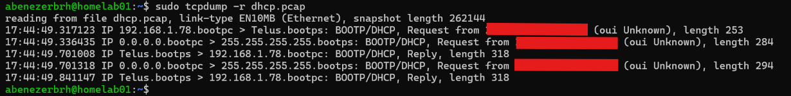
 
**Screenshot 7**
 
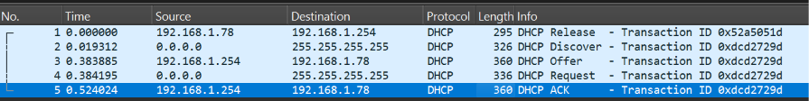
 
**Screenshot 8**
 
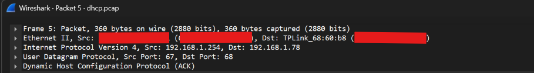
 
---
 
## 7. Capturing ARP
 
### Command
 
```bash
sudo timeout 15 tcpdump -i wlp2s0 -w arp.pcap arp & sleep 2; sudo ip neigh flush all; ping -c 3 192.168.1.254
```
 
### Observations
 
Clearing the neighbor table forced homelab01 to look up MAC addresses again. Six packets were captured:
 
| # | Who | Message |
|---|---|---|
| 1 | homelab01 (broadcast) | Who has 192.168.1.254? Tell 192.168.1.78 |
| 2 | homelab01 (broadcast) | Who has 192.168.1.86? Tell 192.168.1.78 |
| 3 | Laptop -> homelab01 | 192.168.1.86 is at (laptop MAC) |
| 4 | Router -> homelab01 | 192.168.1.254 is at (router MAC) |
| 5 | Router | Who has 192.168.1.78? |
| 6 | homelab01 -> router | 192.168.1.78 is at (homelab01 MAC) |
 
### What was learned
 
ARP turns a local IPv4 address into a MAC address. A machine needs this before it can deliver frames to another device on the same network.
 
- Requests are broadcast because the sender does not know which device has that IP.
- Replies go straight back to whoever asked.
- Flushing the table also removed the laptop's entry, so homelab01 had to look it up again to keep the SSH session going (packets 2 and 3).

This connected:
 
- **Layer 3:** IP addressing
- **Layer 2:** MAC addressing
- **ARP:** the mapping between the two

**Screenshot 9**
 
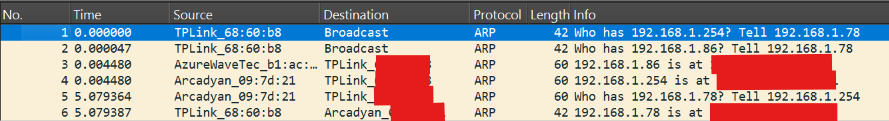
 
---
 
## 8. Testing Device Reachability

### Command

    ping -c 3 192.168.1.86; ip neigh show 192.168.1.86

### Observations

- The ping failed with 100% packet loss.
- Right after, `ip neigh` showed the laptop's MAC address with the state `REACHABLE`.

### What was learned

Before sending a ping, homelab01 has to find the laptop's MAC address using ARP. The laptop answered the ARP request but ignored the ping itself.

Windows Firewall blocks incoming ping (ICMP echo) by default, but it doesn't block ARP. So the laptop was online and reachable at Layer 2, it just wasn't answering ping.

I also tried `nmap -Pn`, but it didn't prove anything here. `-Pn` assumes the host is up instead of checking, and all 1000 ports came back filtered because the firewall dropped everything.

I ran into the same thing in my Computer Networks lab, where we had to disable the Windows firewall on the lab PCs before pings would work. Outside a lab, a safer fix is to add a firewall rule that allows incoming ping (ICMP echo) instead of turning the whole firewall off.

> A failed ping does not automatically mean a device is offline.

**Screenshot 10**

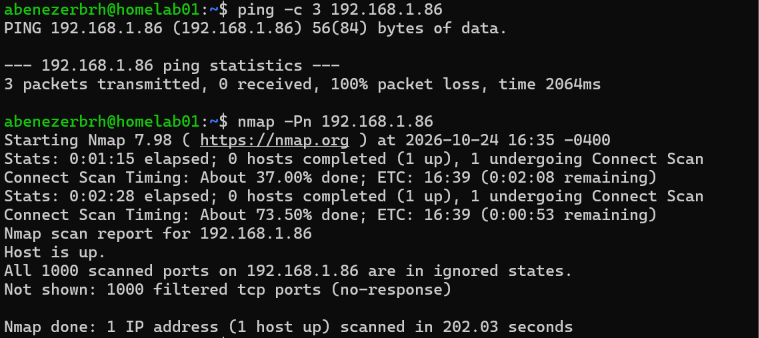

### Fix: allowing ping through the firewall

Instead of turning the firewall off, I added a rule on the laptop that only allows incoming ping:

    New-NetFirewallRule -DisplayName "Allow ICMPv4 Ping" -Protocol ICMPv4 -IcmpType 8 -Direction Inbound -Action Allow

After that, the ping from homelab01 succeeded with 0% packet loss.


**Screenshot 16**

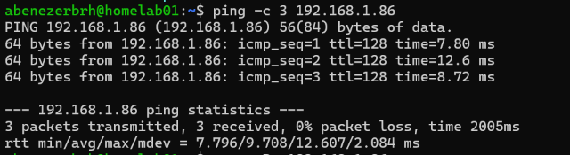

The added rule was removed after taking the screenshot.

---
 
## 9. Capturing DNS Traffic
 
### Command
 
```bash
sudo timeout 15 tcpdump -i wlp2s0 -w dns.pcap port 53 & sleep 2; dig github.com
```
 
### Observations
 
Two different DNS paths showed up.
 
**homelab01's own lookups go to the router:**
 
```text
homelab01 192.168.1.78
   |  query: github.com
   v
Router 192.168.1.254
   |  answer: IPv4 addresses
   v
homelab01
```
 
**My laptop's lookups go through Pi-hole on homelab01:**
 
```text
Laptop 192.168.1.86
   |  query
   v
Pi-hole on homelab01 192.168.1.78
   |  forwarded query
   v
Cloudflare DNS 1.1.1.1 / 1.0.0.1
   |  response
   v
Pi-hole -> Laptop
```
 
### What was learned
 
- DNS uses port 53.
- A DNS request can pass through several servers before an answer comes back.
- Pi-hole acts as a middleman: it answers the laptop and does the outside lookup itself. This is where DNS blocking and logging happen.

**Screenshot 11**
 

 
**Screenshot 12**
 
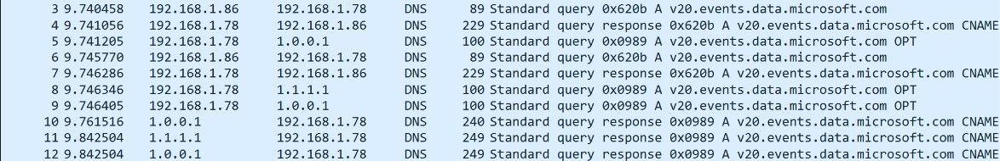

Looking at the actual packets, the flow wasn't a simple chain:

- The laptop's query (ID `0x620b`) was answered by Pi-hole in under 1 ms, before Pi-hole contacted Cloudflare at all. Pi-hole already had the answer in its cache.
- Pi-hole then sent its own query to Cloudflare with a different ID (`0x0989`), most likely to refresh the cached record before it expired.
- Pi-hole sent that query to both 1.1.1.1 and 1.0.0.1, its two configured upstream servers.

The different query IDs show that Pi-hole doesn't just forward the laptop's packet. It answers the client itself and makes a separate lookup upstream.
 
---
 
## 10. Problems Encountered
 
### Problem: `apt update` failed with "not valid yet" errors
 
#### Cause
 
The system clock was hours behind, so the repository files looked like they were dated in the future.
 
#### Fix
 
```bash
sudo timedatectl set-ntp false
sudo timedatectl set-time "YYYY-MM-DD HH:MM:SS"
sudo timedatectl set-ntp true
```
 
#### Verified
 
`apt update` completed without errors.
 
**Screenshot 13**
 
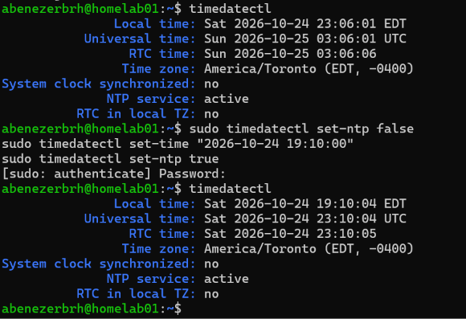
 
---
 
### Problem: DHCP capture got 0 packets
 
#### Cause
 
The capture finished before the DHCP renewal command ran. The tool worked, the test timing did not.
 
#### Fix
 
Start the capture and trigger the renewal in one command:
 
```bash
sudo timeout 30 tcpdump -i wlp2s0 -w dhcp.pcap port 67 or port 68 & sleep 3; sudo systemd-run networkctl reconfigure wlp2s0
```
 
---
 
### Problem: `nmap` command not found
 
#### Cause
 
`nmap` was not installed.
 
#### Fix
 
```bash
sudo apt update
sudo apt install nmap
```
 
---
 
### Problem: Ping to the laptop failed

#### Cause

Windows Firewall blocks incoming ping (ICMP echo requests) by default. The laptop was still online: `ip neigh` showed it as `REACHABLE` because it answered ARP.

#### Fix

Added a temporary firewall rule on the laptop that only allows incoming ping, instead of turning the whole firewall off:

    New-NetFirewallRule -DisplayName "Allow ICMPv4 Ping" -Protocol ICMPv4 -IcmpType 8 -Direction Inbound -Action Allow

#### Verified

The ping from homelab01 succeeded with 0% packet loss. The replies showed `ttl=128`, the default for Windows.

#### Cleanup

Removed the rule afterward, since the laptop is on a shared network:

    Remove-NetFirewallRule -DisplayName "Allow ICMPv4 Ping"

---

### 10.5 Remote access with Tailscale

I can't port forward on the shared router, so I set up Tailscale, a WireGuard-based VPN that only makes outbound connections.

    curl -fsSL https://tailscale.com/install.sh | sh
    sudo tailscale up
    tailscale ip -4

I tested it by connecting over SSH from my phone's hotspot.

## 11. Break and Fix Tests

### Test 1: Wrong DNS server

#### Break

Changed homelab01's DNS server from the router (192.168.1.254) to 10.9.9.9, an address with no DNS server:

    sudo resolvectl dns wlp2s0 10.9.9.9

#### Symptom

- `ping 8.8.8.8` still worked.
- `ping google.com` failed with "Temporary failure in name resolution."

So the network was working, but names couldn't be turned into IP addresses.

#### Diagnosis

- `resolvectl status wlp2s0` showed the DNS server was now 10.9.9.9 instead of 192.168.1.254.
- `dig google.com` returned "communications error to 10.9.9.9#53: timed out" three times, then "no servers could be reached."

#### Root cause

homelab01 was sending DNS queries to an address where no DNS server exists, so every lookup timed out.

#### Fix

Reverted to the original DNS configuration from DHCP:

    sudo resolvectl revert wlp2s0

#### Verified

- `resolvectl status wlp2s0` showed 192.168.1.254 again.
- `ping google.com` worked.

**Screenshot 14**

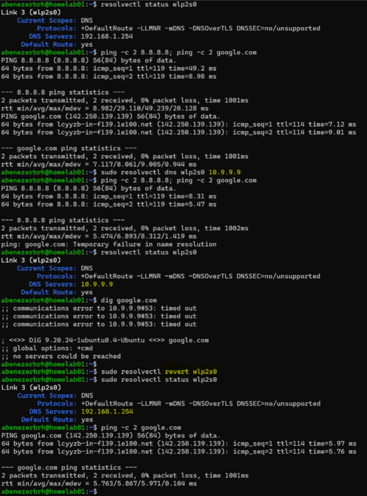 

---
 
### Test 2: Wrong default gateway

> My first attempt at this test cut off my remote access. See the incident below. The results here are from a second run, done from home over the local network.

#### Break

Replaced the real default gateway (192.168.1.254) with 192.168.1.250, an address with no device behind it:

```bash
sudo ip route del default
sudo ip route add default via 192.168.1.250 dev wlp2s0
```

#### Symptom

- `ping 192.168.1.254` (the router) still worked: 4 sent, 4 received, 0% packet loss.
- `ping google.com` resolved the name to 142.250.139.139, but every ping failed with "From 192.168.1.78 Destination Host Unreachable" and 100% packet loss.

#### Diagnosis

- The name still resolved because the DNS server (the router at 192.168.1.254) is on the local network, so DNS lookups don't need the gateway.
- The "Destination Host Unreachable" message came from homelab01 itself (192.168.1.78), not from a router out on the internet. The packets never left the machine.
- `ip neigh show 192.168.1.250` showed `FAILED`. homelab01 sent an ARP request asking "who has 192.168.1.250?" and no device answered.

#### Root cause

Local traffic is sent directly to the device using the `192.168.1.0/24` route, so it doesn't need the gateway. Traffic for any other network is sent to the default gateway. With the gateway set to 192.168.1.250, homelab01 couldn't find a MAC address for it, so every packet headed outside the local network was dropped before it left the machine.

#### Fix

Put the real gateway back:

```bash
sudo ip route del default
sudo ip route add default via 192.168.1.254 dev wlp2s0
```
#### Verified

- `ip route` showed `default via 192.168.1.254` again.
- `ping google.com` worked.

**Screenshot 15**

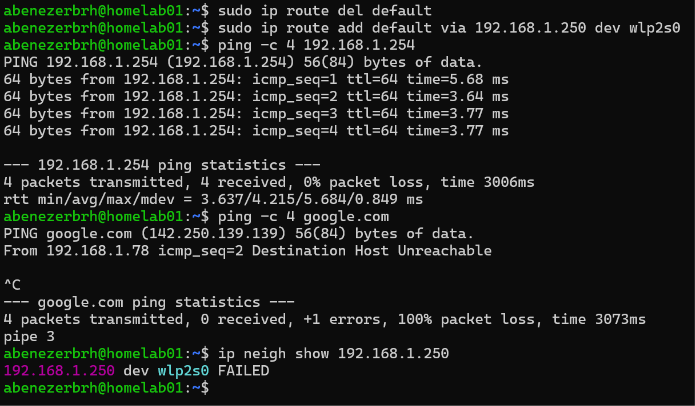

#### Comparison with Test 1

- Test 1 (wrong DNS): IPs worked, names failed.
- Test 2 (wrong gateway): names worked, the internet failed.

The symptoms alone show whether the problem is DNS or routing.

---

### Incident during Test 2: Lost remote access

#### What happened

On my first attempt at Test 2, I changed the default gateway to 192.168.1.250 while connected to homelab01 over SSH through Tailscale from outside the house. The SSH session dropped right away and I couldn't reconnect. I had no way to fix it until I got home about 12 hours later.

#### Root cause

Tailscale needs to reach the internet to connect my laptop to homelab01 from another network, and all internet traffic leaves through the default gateway. With a fake gateway, nothing could get out, so the VPN connection and my SSH session inside it died.

I broke the same path I was using to manage the server.

#### Impact

- No remote access to homelab01 for about 12 hours
- No permanent damage: the route change only lived in memory, so a reboot or a DHCP renewal restores the real gateway

#### Fix

When I got home, I connected my laptop to the same Wi-Fi network as homelab01 and connected over SSH using its local IP instead of Tailscale:

```powershell
ssh abenezerbrh@192.168.1.78
```

This worked because my laptop and homelab01 were on the same local network, so the connection didn't need the default gateway.

Then I put the real gateway back:

```bash
sudo ip route del default
sudo ip route add default via 192.168.1.254 dev wlp2s0
```

With the gateway restored, I reran Test 2 from the local network (results above).

#### Lessons learned

- Know which path you're managing a device through before you change it.
- Run routing tests over the local network (SSH to 192.168.1.78), not over a VPN.
- For risky remote changes, schedule an automatic rollback first, so it undoes itself if access is lost:

```bash
sudo systemd-run --on-active=5min ip route replace default via 192.168.1.254 dev wlp2s0
```

---

## 12. Key Concepts Learned

- IPv4 addressing and CIDR notation
- Subnet and broadcast addresses
- Default gateways as the first hop, and routing tables
- DHCP (Release, Discover, Offer, Request, Ack)
- DNS resolution and upstream DNS servers
- DNS forwarding and caching with Pi-hole
- ARP, the neighbor table, and MAC vendor lookup (OUI)
- Layer 2 vs Layer 3
- ICMP, TTL, and host firewall rules
- Packet capture with tcpdump and analysis in Wireshark
- Telling DNS problems from routing problems by their symptoms
- Remote access with a VPN (Tailscale) when port forwarding isn't an option
- Change safety: knowing your management path before making remote changes
- Time sync and why it matters
- Troubleshooting methodology: symptom, diagnosis, root cause, fix, verification

---
 
## 13. Commands Reference
 
**On homelab01:**
 
```bash
hostname -I
ip -4 addr show wlp2s0
ip route
ip neigh
resolvectl status
dig <name>
ping -c 3 <ip>
nmap -Pn <ip>
timedatectl
sudo tcpdump -i wlp2s0 -w <file>.pcap <filter>
sudo tcpdump -r <file>.pcap
```
 
**On the Windows laptop:**
 
```powershell
ssh abenezerbrh@192.168.1.78
scp abenezerbrh@192.168.1.78:~/<file>.pcap .
ipconfig /all
arp -a
```
 
---
 
## 14. Project Outcome

By the end of the project, I could use the homelab to:

- Identify its network configuration and explain where each setting comes from
- Capture and explain a full DHCP exchange
- Map IP addresses to MAC addresses with ARP
- Trace DNS lookups from homelab01 to the router, and from my laptop through Pi-hole to Cloudflare
- Tell the difference between "unreachable" and "not answering ping"
- Break DNS and the default gateway on purpose and diagnose each from the symptoms
- Capture packets remotely and analyze them in Wireshark
- Reach homelab01 from anywhere using Tailscale
- Check each network layer quickly with a PowerShell triage script
- Document problems using symptom, cause, fix, and verification

The most important result was moving from running commands to understanding what each packet and network service was actually doing.