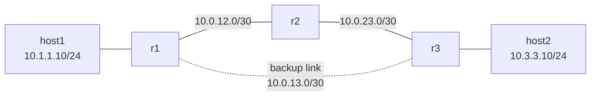

# Project 2 - Build a Small Routed Network

## Overview

This project focused on how routing works between multiple networks.

I built a small network of three routers and two hosts, connected them using static routes only, and then broke the routing on purpose to practice troubleshooting. The goal was to understand how each router decides where to send a packet, and what happens when a route is missing or wrong.

---

## Scope

The entire lab runs inside homelab01 as containers. It is isolated from my home network: no traffic leaves the lab, so I could break routing freely without affecting other devices or cutting off my own SSH access.

---

## Environment

| Item | Value |
|---|---|
| Host | `homelab01`, Dell OptiPlex 5060, Ubuntu Linux |
| Lab tool | Containerlab (with Docker) |
| Node image | `nicolaka/netshoot:v0.13` (Linux with ping, traceroute, tcpdump, iproute2) |
| Routers | 3 Linux containers with IP forwarding enabled |
| Hosts | 2 Linux containers |
| Topology file | [`topology.clab.yml`](topology.clab.yml) |

---

## Topology



### Addressing

| Device | Interface | IP address | Connects to | Network |
|---|---|---|---|---|
| host1 | eth1 | 10.1.1.10/24 | r1 eth1 | 10.1.1.0/24 |
| r1 | eth1 | 10.1.1.1/24 | host1 | 10.1.1.0/24 |
| | eth2 | 10.0.12.1/30 | r2 eth1 | 10.0.12.0/30 |
| | eth3 | 10.0.13.1/30 | r3 eth2 (backup) | 10.0.13.0/30 |
| r2 | eth1 | 10.0.12.2/30 | r1 eth2 | 10.0.12.0/30 |
| | eth2 | 10.0.23.1/30 | r3 eth1 | 10.0.23.0/30 |
| r3 | eth1 | 10.0.23.2/30 | r2 eth2 | 10.0.23.0/30 |
| | eth2 | 10.0.13.2/30 | r1 eth3 (backup) | 10.0.13.0/30 |
| | eth3 | 10.3.3.1/24 | host2 | 10.3.3.0/24 |
| host2 | eth1 | 10.3.3.10/24 | r3 eth3 | 10.3.3.0/24 |

- **Default gateways:** host1 uses 10.1.1.1 (r1), host2 uses 10.3.3.1 (r3)
- **Router links use /30:** a /30 has exactly two usable addresses, one for each router on the link

---

## 1. Installing Docker and Containerlab

### Commands

```bash
curl -fsSL https://get.docker.com | sh
```

```bash
bash -c "$(curl -sL https://get.containerlab.dev)"
```

```bash
docker --version; containerlab version
```

### What was learned

- Containerlab runs each router and host as a Docker container.
- The whole network is defined in one text file, so it can be rebuilt the same way every time and kept in Git.

---

## 2. The Topology File

The topology file defines every device, its IP addresses, and the links between them.

### Key parts

- **`kind: linux`:** each device is a small Linux container
- **`net.ipv4.ip_forward: "1"`:** turns a Linux container into a router. Without it, Linux drops packets that aren't addressed to itself.
- **`exec`:** commands that run when each device starts, used to set IP addresses and routes
- **`ip route del default` on the routers:** removes the default route Docker adds. Without this, a missing route would quietly send traffic out to my real network instead of failing, which would hide routing problems.
- **`links`:** the virtual cables between devices. `eth0` is reserved for Containerlab management, so lab links start at `eth1`.

---

## 3. Deploying and Verifying the Lab

### Commands

```bash
sudo containerlab deploy -t topology.clab.yml
```

```bash
for n in r1 r2 r3 host1 host2; do echo "== $n"; sudo docker exec clab-routed-$n ip -br -4 addr; done
```

### Observations

- The deploy table listed each device with a `172.20.20.x` address. These are management addresses on `eth0`, not part of the lab network.
- The lab addresses (10.x.x.x) were on `eth1` to `eth3` and matched the addressing table.

### What was learned

Containerlab keeps a separate **management network** (`172.20.20.0/24`) for reaching each container, apart from the **data network** I built. Production networks often do the same, so admins can still reach devices when the main network breaks.

**Screenshot 1**


---

## 4. Baseline: No Routes

### Commands

```bash
sudo docker exec clab-routed-r1 ip route
```

```bash
sudo docker exec clab-routed-host1 ping -c 2 10.1.1.1
sudo docker exec clab-routed-host1 ping -c 2 10.3.3.10
```

### Observations

- r1's routing table only listed its directly connected networks.
- host1 could ping r1 (same network).
- host1 could not ping host2. r1 replied with "Destination Net Unreachable."

### What was learned

Each router only knows the networks it's directly plugged into. r1 received the packet, found no route to 10.3.3.0/24, and sent an error back to host1.

This is different from the "Destination Host Unreachable" error in Project 1, which came from my own machine because it couldn't find the gateway's MAC address. **Who sends the error shows where the problem is.**

**Screenshot 2**


---

## 5. Adding Static Routes

### Command format

```bash
sudo docker exec clab-routed-<ROUTER> ip route add <DEST_NETWORK>/<PREFIX> via <NEXT_HOP_IP>
```

**Rule:** the next hop must be a **neighbor's** IP on a network the router is directly connected to, never the router's own IP.

### Routes added

| Router | Destination | Next hop |
|---|---|---|
| r1 | 10.3.3.0/24 | 10.0.12.2 (r2) |
| r2 | 10.3.3.0/24 | 10.0.23.2 (r3) |
| r2 | 10.1.1.0/24 | 10.0.12.1 (r1) |
| r3 | 10.1.1.0/24 | 10.0.23.1 (r2) |

### Observations

- **"Nexthop has invalid gateway":** I first tried to add a route on r1 using 10.0.23.2 as the next hop. r1 isn't connected to the 10.0.23.0/30 network, so it can't reach that address directly, and Linux refused the route.
- **Routes in one direction weren't enough:** at first, I added a route on r1 pointing to r2, and a route on r2 pointing to r3, toward host2's network. I thought that was enough, so I tested it with a ping. The requests could reach host2, but the replies couldn't come back, because I hadn't configured the return path to 10.1.1.0/24 on r3 and r2.
- **After adding the return routes,** host1 and host2 could ping each other.
- The replies showed `ttl=61`. The reply starts at 64 on Linux, and each of the 3 routers subtracts 1.

### What was learned

- Each router only needs to know the **next hop**, not the whole path.
- Routing has to work **in both directions**. A missing return route breaks the connection even when the path forward is correct.
- TTL shows how many routers a packet passed through.

**Screenshot 3**


**Screenshot 4**


---

## 6. Tracing the Path

### Command

```bash
sudo docker exec clab-routed-host1 traceroute -n 10.3.3.10
```

### Observations

### Observations

The traceroute from host1 to host2 showed four hops:

| Hop | IP address | Device | Interface |
|---|---|---|---|
| 1 | 10.1.1.1 | r1 | eth1, facing host1 |
| 2 | 10.0.12.2 | r2 | eth1, on the r1 to r2 link |
| 3 | 10.0.23.2 | r3 | eth1, on the r2 to r3 link |
| 4 | 10.3.3.10 | host2 | eth1 |

Each hop shows the address of the interface where the packet **entered** that router. The path matches the static routes: host1 → r1 → r2 → r3 → host2, without using the backup link.

**Screenshot 5**


---

## 7. Making the Routes Permanent

Routes added by hand only live in memory and disappear when the lab is rebuilt. I added them to each router's `exec` list in the topology file, after `ip route del default`:

```yaml
r1:
  exec:
    - ip route add 10.3.3.0/24 via 10.0.12.2

r2:
  exec:
    - ip route add 10.3.3.0/24 via 10.0.23.2
    - ip route add 10.1.1.0/24 via 10.0.12.1

r3:
  exec:
    - ip route add 10.1.1.0/24 via 10.0.23.1
```

Then I rebuilt the lab from scratch to confirm the file alone produces a working network:

```bash
sudo containerlab deploy -t topology.clab.yml --reconfigure
```

### Observations

- After the rebuild, host1 and host2 could ping each other in both directions with `ttl=61`.

**Screenshot 6**


---

## 8. Problems Encountered

### Problem: Lab IP addresses missing after the first deploy

#### Cause

Only the management addresses on `eth0` showed up, and the routers still had Docker's default route, so the `exec` commands hadn't run. The exact reason wasn't clear.

#### Fix

Rebuilt the lab from scratch:

```bash
sudo containerlab deploy -t topology.clab.yml --reconfigure
```

#### Verified

The deploy log showed every `exec` command running, and each interface had its lab address.

---

### Problem: "Nexthop has invalid gateway"

#### Cause

The next hop (10.0.23.2) wasn't on a network directly connected to r1.

#### Fix

Used r1's actual neighbor instead: `via 10.0.12.2`.

---

### Problem: Ping failed after adding routes to the topology file

#### Cause

r2 had the route to 10.3.3.0/24 written twice, and was missing its route back to 10.1.1.0/24. Replies from host2 had no way back to host1.

#### Fix

Replaced the duplicate line with the missing return route:

```yaml
- ip route add 10.1.1.0/24 via 10.0.12.1
```

#### Verified

After rebuilding, pings worked in both directions.

---

## 9. Break and Fix Tests

_To be added_

---

## 10. Key Concepts Learned

- Static routing and next hops
- Directly connected vs remote networks
- Why router links use /30 subnets
- IP forwarding on Linux
- Routing has to work in both directions
- TTL as a hop counter
- "Destination Net Unreachable" vs "Destination Host Unreachable"
- Management network vs data network
- Infrastructure as code: defining a network in a file

_More to be added_

---

## 11. Commands Reference

**On homelab01:**

```bash
sudo containerlab deploy -t topology.clab.yml
sudo containerlab deploy -t topology.clab.yml --reconfigure
sudo containerlab destroy -t topology.clab.yml
sudo docker exec clab-routed-<node> ip -br -4 addr
sudo docker exec clab-routed-<node> ip route
sudo docker exec clab-routed-<node> ip route add <network> via <next-hop>
sudo docker exec clab-routed-<node> ip route del <network>
sudo docker exec clab-routed-<node> ping -c 2 <ip>
sudo docker exec clab-routed-<node> traceroute -n <ip>
```

---

## 12. Project Outcome

_To be added_