# Project 2 - Build a Small Routed Network

## Overview

This project focused on how routing works between multiple networks.

I built a small network of three routers and two hosts, connected them using static routes only, and then broke the routing on purpose to practice troubleshooting. The goal was to understand how each router decides where to send a packet, and what happens when a route is missing or wrong.

---

## Scope

The entire lab runs inside homelab01 as containers. It is isolated from my home network: no traffic leaves the lab, so I could break routing freely without affecting other devices or cutting off my own SSH access.

---

## Environment

| Item | Value |
|---|---|
| Host | `homelab01`, Dell OptiPlex 5060, Ubuntu Linux |
| Lab tool | Containerlab (with Docker) |
| Node image | `nicolaka/netshoot:v0.13` (Linux with ping, traceroute, tcpdump, iproute2) |
| Routers | 3 Linux containers with IP forwarding enabled |
| Hosts | 2 Linux containers |
| Topology file | [`topology.clab.yml`](topology.clab.yml) |

---

## Topology

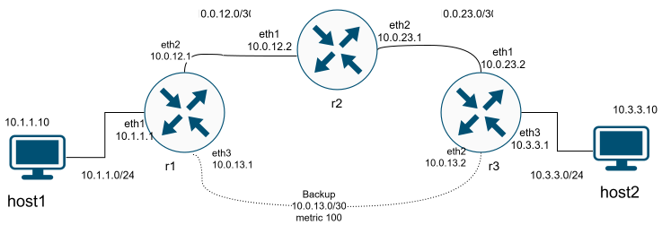


### Addressing

| Device | Interface | IP address | Connects to | Network |
|---|---|---|---|---|
| host1 | eth1 | 10.1.1.10/24 | r1 eth1 | 10.1.1.0/24 |
| r1 | eth1 | 10.1.1.1/24 | host1 | 10.1.1.0/24 |
| | eth2 | 10.0.12.1/30 | r2 eth1 | 10.0.12.0/30 |
| | eth3 | 10.0.13.1/30 | r3 eth2 (backup) | 10.0.13.0/30 |
| r2 | eth1 | 10.0.12.2/30 | r1 eth2 | 10.0.12.0/30 |
| | eth2 | 10.0.23.1/30 | r3 eth1 | 10.0.23.0/30 |
| r3 | eth1 | 10.0.23.2/30 | r2 eth2 | 10.0.23.0/30 |
| | eth2 | 10.0.13.2/30 | r1 eth3 (backup) | 10.0.13.0/30 |
| | eth3 | 10.3.3.1/24 | host2 | 10.3.3.0/24 |
| host2 | eth1 | 10.3.3.10/24 | r3 eth3 | 10.3.3.0/24 |

- **Default gateways:** host1 uses 10.1.1.1 (r1), host2 uses 10.3.3.1 (r3)
- **Router links use /30:** a /30 has exactly two usable addresses, one for each router on the link

---

## 1. Installing Docker and Containerlab

### Commands

```bash
curl -fsSL https://get.docker.com | sh
```

```bash
bash -c "$(curl -sL https://get.containerlab.dev)"
```

```bash
docker --version; containerlab version
```

### What was learned

- Containerlab runs each router and host as a Docker container.
- The whole network is defined in one text file, so it can be rebuilt the same way every time and kept in Git.

---

## 2. The Topology File

The topology file defines every device, its IP addresses, and the links between them.

### Key parts

- **`kind: linux`:** each device is a small Linux container
- **`net.ipv4.ip_forward: "1"`:** turns a Linux container into a router. Without it, Linux drops packets that aren't addressed to itself.
- **`exec`:** commands that run when each device starts, used to set IP addresses and routes
- **`ip route del default` on the routers:** removes the default route Docker adds. Without this, a missing route would quietly send traffic out to my real network instead of failing, which would hide routing problems.
- **`links`:** the virtual cables between devices. `eth0` is reserved for Containerlab management, so lab links start at `eth1`.

---

## 3. Deploying and Verifying the Lab

### Commands

```bash
sudo containerlab deploy -t topology.clab.yml
```

```bash
for n in r1 r2 r3 host1 host2; do echo "== $n"; sudo docker exec clab-routed-$n ip -br -4 addr; done
```

### Observations

- The deploy table listed each device with a `172.20.20.x` address. These are management addresses on `eth0`, not part of the lab network.
- The lab addresses (10.x.x.x) were on `eth1` to `eth3` and matched the addressing table.

### What was learned

Containerlab keeps a separate **management network** (`172.20.20.0/24`) for reaching each container, apart from the **data network** I built. Production networks often do the same, so admins can still reach devices when the main network breaks.

**Screenshot 1**

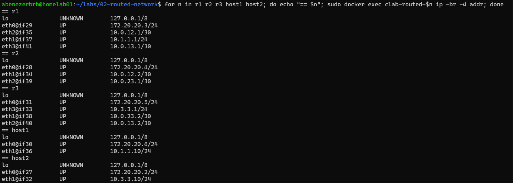

---

## 4. Baseline: No Routes

### Commands

```bash
sudo docker exec clab-routed-host2 ping -c 2 10.1.1.10
sudo docker exec clab-routed-host1 ping -c 2 10.3.3.10
```

### Observations

- host2 could not ping host1. r3 (10.3.3.1) replied with "Destination Net Unreachable."
- host1 could not ping host2. r1 (10.1.1.1) replied with "Destination Net Unreachable."

### What was learned

Each router only knows the networks it's directly plugged into. r1 received the packet, found no route to 10.3.3.0/24, and sent an error back to host1.

This is different from the "Destination Host Unreachable" error in Project 1, which came from my own machine because it couldn't find the gateway's MAC address. **Who sends the error shows where the problem is.**

**Screenshot 2**

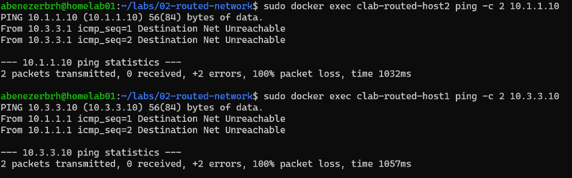

---

## 5. Adding Static Routes

### Command format

```bash
sudo docker exec clab-routed-<ROUTER> ip route add <DEST_NETWORK>/<PREFIX> via <NEXT_HOP_IP>
```

**Rule:** the next hop must be a **neighbor's** IP on a network the router is directly connected to, never the router's own IP.

### Routes added

| Router | Destination | Next hop |
|---|---|---|
| r1 | 10.3.3.0/24 | 10.0.12.2 (r2) |
| r2 | 10.3.3.0/24 | 10.0.23.2 (r3) |
| r2 | 10.1.1.0/24 | 10.0.12.1 (r1) |
| r3 | 10.1.1.0/24 | 10.0.23.1 (r2) |

### Observations

- **"Nexthop has invalid gateway":** I first tried to add a route on r1 using 10.0.23.2 as the next hop. r1 isn't connected to the 10.0.23.0/30 network, so it can't reach that address directly, and Linux refused the route.
- **Routes in one direction weren't enough:** at first, I added a route on r1 pointing to r2, and a route on r2 pointing to r3, toward host2's network. I thought that was enough, so I tested it with a ping. The requests could reach host2, but the replies couldn't come back, because I hadn't configured the return path to 10.1.1.0/24 on r3 and r2.
- **After adding the return routes,** host1 and host2 could ping each other.
- The replies showed `ttl=61`. The reply starts at 64 on Linux, and each of the 3 routers subtracts 1.

### What was learned

- Each router only needs to know the **next hop**, not the whole path.
- Routing has to work **in both directions**. A missing return route breaks the connection even when the path forward is correct.
- TTL shows how many routers a packet passed through.

**Screenshot 3**

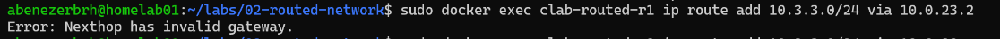

**Screenshot 4**


---

## 6. Tracing the Path

### Command

```bash
sudo docker exec clab-routed-host1 traceroute -n 10.3.3.10
```

### Observations

### Observations

The traceroute from host1 to host2 showed four hops:

| Hop | IP address | Device | Interface |
|---|---|---|---|
| 1 | 10.1.1.1 | r1 | eth1, facing host1 |
| 2 | 10.0.12.2 | r2 | eth1, on the r1 to r2 link |
| 3 | 10.0.23.2 | r3 | eth1, on the r2 to r3 link |
| 4 | 10.3.3.10 | host2 | eth1 |

Each hop shows the address of the interface where the packet **entered** that router. The path matches the static routes: host1 → r1 → r2 → r3 → host2, without using the backup link.

**Screenshot 5**

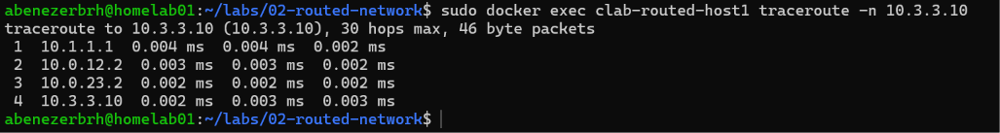

---

## 7. Making the Routes Permanent

Routes added by hand only live in memory and disappear when the lab is rebuilt. I added them to each router's `exec` list in the topology file, after `ip route del default`:

```yaml
r1:
  exec:
    - ip route add 10.3.3.0/24 via 10.0.12.2

r2:
  exec:
    - ip route add 10.3.3.0/24 via 10.0.23.2
    - ip route add 10.1.1.0/24 via 10.0.12.1

r3:
  exec:
    - ip route add 10.1.1.0/24 via 10.0.23.1
```

Then I rebuilt the lab from scratch to confirm the file alone produces a working network:

```bash
sudo containerlab deploy -t topology.clab.yml --reconfigure
```

### Observations

- After the rebuild, host1 and host2 could ping each other in both directions with `ttl=61`.

**Screenshot 6**

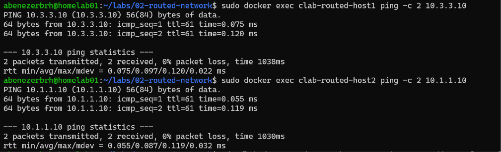

---

## 8. Problems Encountered

### Problem: Lab IP addresses missing after the first deploy

#### Cause

Only the management addresses on `eth0` showed up, and the routers still had Docker's default route, so the `exec` commands hadn't run. The exact reason wasn't clear.

#### Fix

Rebuilt the lab from scratch:

```bash
sudo containerlab deploy -t topology.clab.yml --reconfigure
```

#### Verified

The deploy log showed every `exec` command running, and each interface had its lab address.

---

### Problem: "Nexthop has invalid gateway"

#### Cause

The next hop (10.0.23.2) wasn't on a network directly connected to r1.

#### Fix

Used r1's actual neighbor instead: `via 10.0.12.2`.

---

### Problem: Ping failed after adding routes to the topology file

#### Cause

r2 had the route to 10.3.3.0/24 written twice, and was missing its route back to 10.1.1.0/24. Replies from host2 had no way back to host1.

#### Fix

Replaced the duplicate line with the missing return route:

```yaml
- ip route add 10.1.1.0/24 via 10.0.12.1
```

#### Verified

After rebuilding, pings worked in both directions.

---

## 9. Break and Fix Tests

### Test 1: Missing return route

#### Break

Removed r2's route back to host1's network:

```bash
sudo docker exec clab-routed-r2 ip route del 10.1.1.0/24 via 10.0.12.1
```

#### Symptom

- Before the change, host1 could ping host2 (2 sent, 2 received).
- After the change, the same ping failed with 100% packet loss, and no error message appeared on host1.

**Screenshot 7**

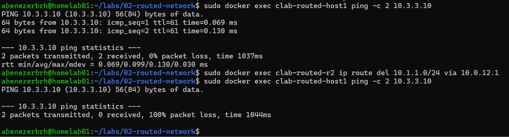

#### Diagnosis

I ran `tcpdump` on host2's `eth1` while pinging from host1:

- **Echo requests** from 10.1.1.10 still arrived at host2, so the path forward was fine.
- host2 sent an **echo reply** for every request.
- Right after, r2 (10.0.23.1, its side of the r2 to r3 link) sent host2 an ICMP message: **"net 10.1.1.10 unreachable."**

The capture also shows the difference before and after the change: the first ping's replies went through normally, and the second ping's reply triggered the unreachable error.

**Screenshot 8**

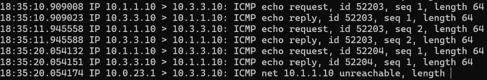

#### Root cause

The reply from host2 traveled to r3, then to r2. r2 no longer had a route to 10.1.1.0/24, so it dropped the reply and sent an error back to the reply's sender, host2. host1 never got a reply, and never got an error either, because the error went to host2 instead.

Only one unreachable message appeared even though every reply was dropped. Linux rate-limits ICMP error messages so a router doesn't flood the network with them.

#### Fix

```bash
sudo docker exec clab-routed-r2 ip route add 10.1.1.0/24 via 10.0.12.1
```

#### Verified

I restored r2's route back to host1's network through r1 (via 10.0.12.1). After that, pinging host2 from host1 worked again.

### Test 2: Wrong default gateway on a host

#### Break

Changed host1's default gateway from 10.1.1.1 (r1's `eth1`) to 10.1.1.5, an address with no device behind it:

```bash
sudo docker exec clab-routed-host1 ip route replace default via 10.1.1.5
```

#### Symptom

Pinging host2 from host1 failed with **"From 10.1.1.10 Destination Host Unreachable"** and 100% packet loss.

#### Diagnosis

- The error came from **10.1.1.10, host1 itself**, not from a router. The packets never left host1.
- `ip neigh` on host1 showed `10.1.1.5 dev eth1 FAILED`. host1 sent an ARP request asking "who has 10.1.1.5?" and no device answered.

#### Root cause

host2 is on a different network, so host1 has to send the packet to its default gateway first. To do that, it needs the gateway's MAC address. With the gateway set to 10.1.1.5, ARP got no answer, so host1 had nowhere to send the packet and dropped it.

This matches the wrong gateway test in Project 1: "Destination Host Unreachable" from your own machine plus a FAILED ARP entry means the gateway can't be found.

#### Fix

```bash
sudo docker exec clab-routed-host1 ip route replace default via 10.1.1.1
```

#### Verified

Pinging host2 from host1 worked again, with `ttl=61` and 0% packet loss.

The FAILED entry for 10.1.1.5 stayed in `ip neigh` for a while after the fix. The neighbor table is a separate cache, and old entries are only cleaned up after a timeout. It didn't affect traffic.

**Screenshot 9**

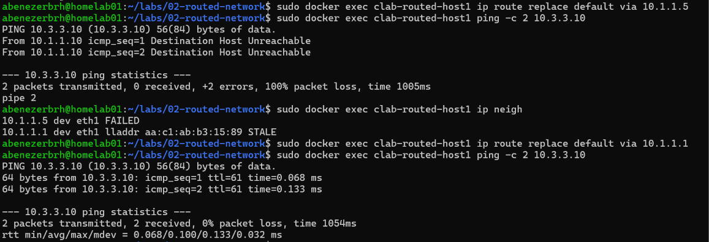

### Test 3: Link down

#### Break

Took down r2's `eth2`, the link to r3:

```bash
sudo docker exec clab-routed-r2 ip link set eth2 down
```

#### Symptom

- Before the change, host1 could ping host2.
- After the change, the ping failed with **"From 10.0.12.2 Destination Net Unreachable."**

#### Diagnosis

- The error came from **10.0.12.2, r2's `eth1`** (its side of the r1 to r2 link). Routers reply from the interface the packet came in on.
- `ip route` on r2 showed that two routes were gone:
  - `10.0.23.0/30` (the directly connected r2 to r3 network)
  - `10.3.3.0/24 via 10.0.23.2` (the static route to host2's network)

**Screenshot 10**

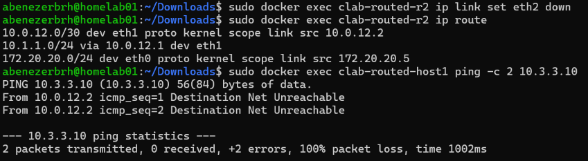

#### Root cause

When the link went down, Linux removed the connected route for that link, and with it every route using a next hop on that link. r2 no longer had any route to 10.3.3.0/24, so it dropped the packets and sent "Net Unreachable" back to host1.

#### Fix

Brought the link back up:

```bash
sudo docker exec clab-routed-r2 ip link set eth2 up
```

The connected route (`10.0.23.0/30`) came back on its own, but the static route did not, and the ping still failed. I had to add the static route again:

```bash
sudo docker exec clab-routed-r2 ip route add 10.3.3.0/24 via 10.0.23.2
```

#### Verified

`ip route` on r2 showed both routes again, and pinging host2 from host1 worked with `ttl=61`.

**Screenshot 11**

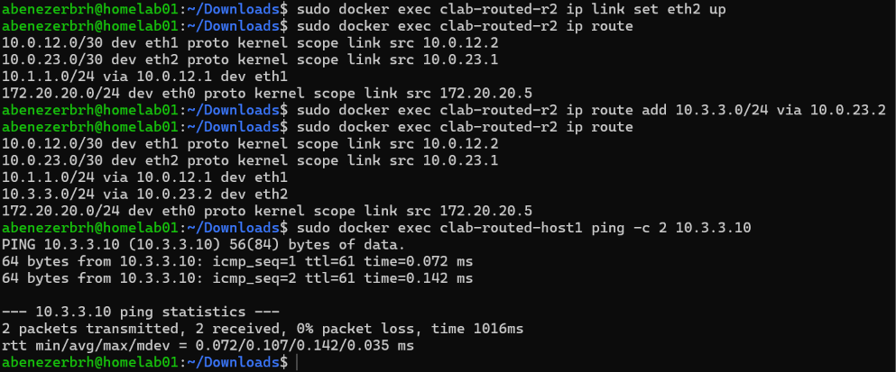

#### What I learned

Linux restores connected routes automatically when a link comes back, but not static routes added by hand. Real routers keep static routes in their saved configuration and reinstall them when the link returns.

### Test 4: Routing loop

#### Break

Changed r2's route to host2's network so it pointed back at r1 instead of forward to r3:

```bash
sudo docker exec clab-routed-r2 ip route del 10.3.3.0/24 via 10.0.23.2
sudo docker exec clab-routed-r2 ip route add 10.3.3.0/24 via 10.0.12.1
```

#### Symptom

Pinging host2 from host1 failed with **"From 10.0.12.2 Time to live exceeded"** and 100% packet loss.

**Screenshot 12**

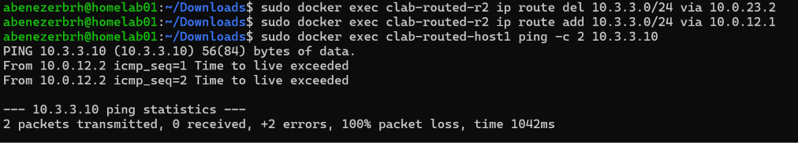

#### Diagnosis

- r1 sends traffic for 10.3.3.0/24 to r2, and r2 now sends it straight back to r1. The packet bounces between the two routers.
- A traceroute to host2 showed r1 and r2 repeating over and over until it hit traceroute's 30-hop limit.
- The error came from r2 (10.0.12.2). host1 sends with a TTL of 64, and each router subtracts 1, alternating r1 and r2. The 64th hop lands on r2, so r2 is the one that dropped the packet and reported it.

#### Root cause

r2's route pointed back toward the router the traffic came from, creating a loop. Without TTL, the packets would circle forever. TTL is what eventually stops them.

#### Fix

Pointed r2's route back at r3:

```bash
sudo docker exec clab-routed-r2 ip route del 10.3.3.0/24 via 10.0.12.1
sudo docker exec clab-routed-r2 ip route add 10.3.3.0/24 via 10.0.23.2
```

Linux won't add a second route to the same network, so the old route had to be deleted first. `ip route replace` does both in one step.

#### Verified

`ip route` on r2 showed `10.3.3.0/24 via 10.0.23.2` again, and pinging host2 from host1 worked with `ttl=61`.

**Screenshot 13**

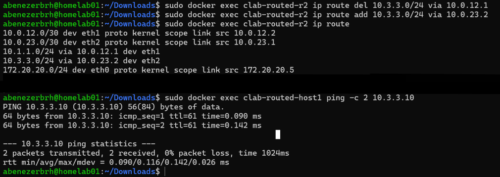

### Test 5: Asymmetric routing

#### Change

Pointed r1's route to host2's network over the backup link, directly to r3, instead of through r2. All other routes stayed the same, so replies still return through r2.

```bash
sudo docker exec clab-routed-r1 ip route del 10.3.3.0/24 via 10.0.12.2
sudo docker exec clab-routed-r1 ip route add 10.3.3.0/24 via 10.0.13.2
```

#### Result

`ip route` on r1 confirmed the new route (`10.3.3.0/24 via 10.0.13.2 dev eth3`), and pinging host2 from host1 still worked with `ttl=61`.

**Screenshot 14**

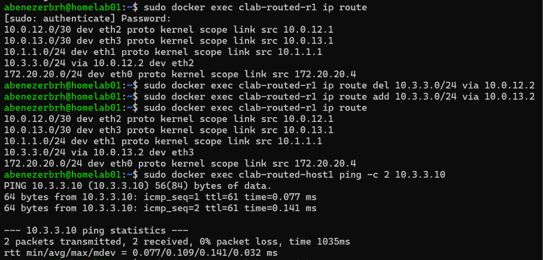

#### Tracing the two paths

| Direction | Path | Hops |
|---|---|---|
| host1 → host2 | host1 → r1 → r3 → host2 (backup link) | 3 |
| host2 → host1 | host2 → r3 → r2 → r1 → host1 | 4 |

The different hop counts show the traffic takes a different path in each direction.

**Screenshot 15**

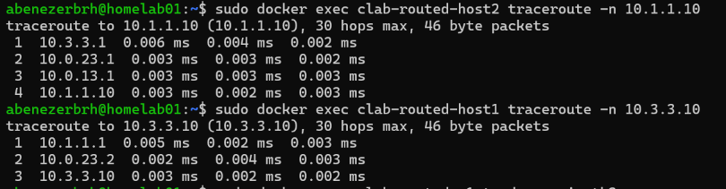

At first the traceroute output was confusing. r3 showed up as `10.0.23.2` (its r2-facing interface), even though the traffic arrived on the backup link, and r1 showed up as `10.0.13.1` on the return trip. Traceroute shows **which router answered**, not which interface the packet used. Linux sends its reply from the interface it would use to reach the sender, which isn't always the one the packet came in on.

#### Confirming with tcpdump

To see the actual path, I ran `tcpdump` on individual router interfaces while sending traffic:

| Capture point | Traffic seen | Meaning |
|---|---|---|
| r1 `eth3` (backup link) | host1 → host2 only (a UDP traceroute probe) | Requests leave r1 over the backup link |
| r3 `eth2` (backup link) | ICMP echo request, host1 → host2 | Requests arrive at r3 over the backup link |
| r3 `eth1` (link to r2) | ICMP echo reply, host2 → host1 | Replies leave r3 toward r2 |

Requests only crossed the backup link, and replies only went through r2.

**Screenshot 16**

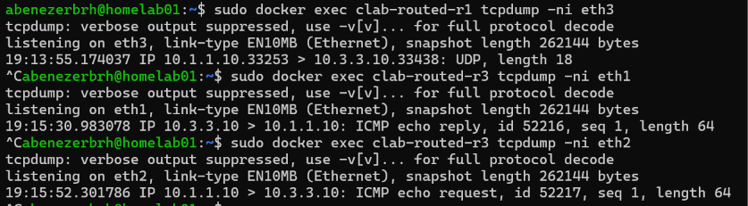

#### What I learned

- Each router decides independently where to send each packet, so the request and reply don't have to take the same path.
- Asymmetric routing works fine for simple traffic, but it can cause problems for devices that need to see both directions, like stateful firewalls.
- Traceroute shows which routers answered, but tcpdump on specific interfaces shows the path the packets actually took.

#### Fix

```bash
sudo docker exec clab-routed-r1 ip route del 10.3.3.0/24 via 10.0.13.2
sudo docker exec clab-routed-r1 ip route add 10.3.3.0/24 via 10.0.12.2
```

#### Verified

After restoring r1's route through r2, `tcpdump` on r3's `eth1` showed both the echo request and the echo reply for each ping, confirming that traffic in both directions goes through r2 again.

### Problem: tcpdump only showed half the traffic

#### Cause

Running tcpdump through `docker exec` without a terminal makes it buffer its output, so some packets weren't printed before I stopped it. Ctrl+C also didn't stop tcpdump inside the container, so captures kept running in the background.

#### Fix

Used `-l` for line-by-line output and `-it` so Ctrl+C reaches the container:

    sudo docker exec -it clab-routed-r3 tcpdump -lni eth1 icmp

### Test 6: Failover with a floating static route

#### Change

Added backup routes over the r1 to r3 link, with a metric of 100. Linux always prefers the route with the lowest metric, and the main routes have no metric (0), so the backups are only used if the main routes disappear. This is called a **floating static route**.

```bash
sudo docker exec clab-routed-r1 ip route add 10.3.3.0/24 via 10.0.13.2 metric 100
sudo docker exec clab-routed-r3 ip route add 10.1.1.0/24 via 10.0.13.1 metric 100
```

`ip route` on r1 and r3 showed two routes to each network: the main one, and the backup marked `metric 100`. A traceroute from host1 to host2 still went r1 → r2 → r3, so the main path was still in use.

#### Break 1: r1 to r2 link down

Took down both ends of the r1 to r2 link to simulate a cable being unplugged:

```bash
sudo docker exec clab-routed-r1 ip link set eth2 down
sudo docker exec clab-routed-r2 ip link set eth1 down
```

#### Prediction

Requests from host1 would fail over to the backup link, but replies would not, because r3 has no way of knowing the r1 to r2 link failed.

#### Symptom

Pinging host2 from host1 failed with 100% packet loss.

**Screenshot 17**

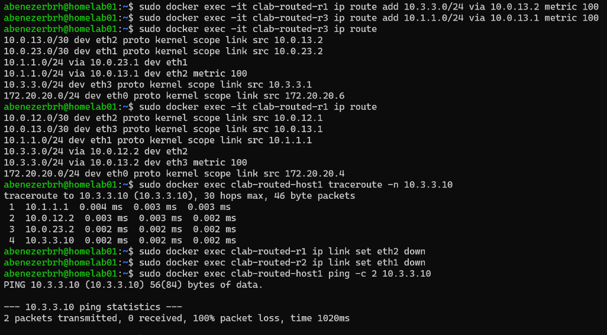

#### Diagnosis

- **r1 failed over:** its main route disappeared when `eth2` went down, and the backup `10.3.3.0/24 via 10.0.13.2 metric 100` took over.
- **r3 did not:** all of r3's links were still up, so its main route to 10.1.1.0/24 through r2 stayed in place.
- The traceroute from host1 only got an answer from r1, then `* * *`. The probes reached r3 over the backup link, but r3 sent its replies toward r2, and r2 had no route back to host1 with its link to r1 down.

#### Root cause

A static route only reacts to a router's **own** links. r1 saw its link go down and switched to the backup. r3 couldn't see a failure two hops away, so it kept sending return traffic into the broken path.

#### Break 2: r2 to r3 link down as well

To simulate r3 detecting the failure, I also took down r3's `eth1`, its link to r2:

```bash
sudo docker exec clab-routed-r3 ip link set eth1 down
```

r3's main route was removed, its backup took over, and the ping worked in both directions with `ttl=62`. A traceroute showed the backup path: r1 (10.1.1.1) → r3 (10.0.13.2) → host2 (10.3.3.10).

The TTL went from 61 to 62 because the backup path only crosses 2 routers instead of 3.

**Screenshot 18**

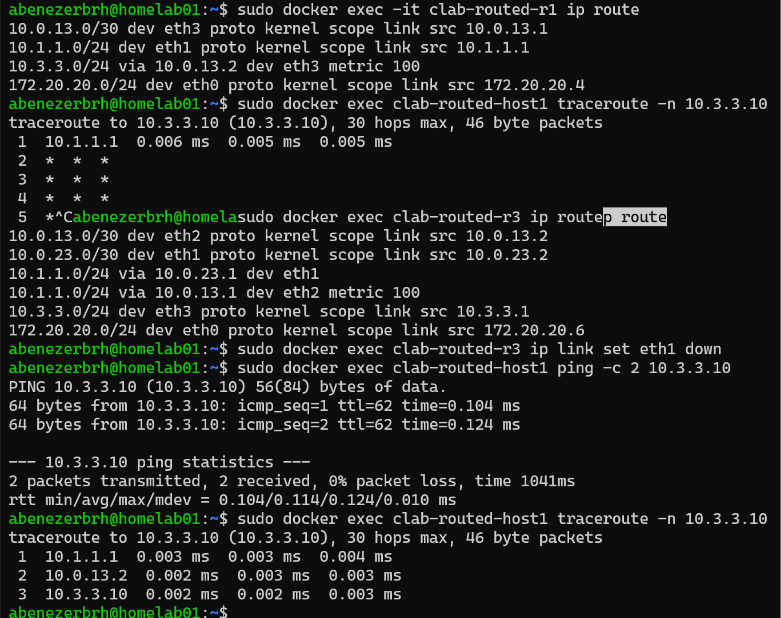

#### Fix

Brought all three interfaces back up, then added back the main static routes that were removed when the links went down:

- r1: `10.3.3.0/24 via 10.0.12.2`
- r3: `10.1.1.0/24 via 10.0.23.1`
- r2: `10.1.1.0/24 via 10.0.12.1`

At first I only restored r1 and r3, and the traceroute still failed. r2 had also lost its route back to host1, since its `eth1` had been taken down too. After adding it back, everything worked.

r2's route to 10.3.3.0/24 survived, because its `eth2` stayed up. Only the far end of that link (r3's `eth1`) went down. Linux removes routes when a router's own interface goes down, not when the other end does.

An interface is **administratively down** when someone turns it off on purpose (like `ip link set eth2 down`), as opposed to going down because the other end or the cable failed (Operationally down).

#### Verified

host1 and host2 could ping each other in both directions with `ttl=61`, back on the original path through r2.

#### What I learned

- A floating static route can provide automatic failover, but only for failures on a router's own links.
- Failover has to happen on **both sides** of a connection. If only one router switches, the return traffic still breaks.
- In a real network, a dynamic routing protocol like OSPF would let r3 learn about the failure automatically.

#### Mirror case: r2 to r3 link down

If only the r2 to r3 link fails, the roles flip. r3 sees its own link go down and switches to the backup, but r1 doesn't, so it keeps sending traffic to r2, which has no route to host2 and drops it. Either way, static routes can only react to failures on a router's own links.

---

## 10. Key Concepts Learned

- Static routing and next hops
- Directly connected vs remote networks
- Why router links use /30 subnets
- IP forwarding on Linux
- Routing has to work in both directions
- TTL as a hop counter, and how it stops routing loops
- "Destination Net Unreachable" vs "Destination Host Unreachable," and who sends each
- ICMP error rate limiting
- What happens to routes when a link goes down
- Administratively down vs operationally down
- Route metrics and floating static routes
- Asymmetric routing
- Why traceroute shows which router answered, not always the interface the packet used
- The limits of static routing, and why dynamic protocols like OSPF exist
- Management network vs data network
- Infrastructure as code: defining a network in a file

---

## 11. Commands Reference

**On homelab01:**

```bash
# Lab
sudo containerlab deploy -t topology.clab.yml
sudo containerlab deploy -t topology.clab.yml --reconfigure
sudo containerlab destroy -t topology.clab.yml

# Interfaces and addresses
sudo docker exec clab-routed-<node> ip -br -4 addr
sudo docker exec clab-routed-<node> ip link set <interface> down
sudo docker exec clab-routed-<node> ip link set <interface> up
sudo docker exec clab-routed-<node> ip neigh

# Routing
sudo docker exec clab-routed-<node> ip route
sudo docker exec clab-routed-<node> ip route add <network> via <next-hop>
sudo docker exec clab-routed-<node> ip route add <network> via <next-hop> metric 100
sudo docker exec clab-routed-<node> ip route replace <network> via <next-hop>
sudo docker exec clab-routed-<node> ip route del <network> via <next-hop>

# Testing
sudo docker exec clab-routed-<node> ping -c 2 <ip>
sudo docker exec clab-routed-<node> traceroute -n <ip>
sudo docker exec -it clab-routed-<node> tcpdump -lni <interface> icmp

# Cleanup
sudo docker exec clab-routed-<node> pkill ping
sudo docker exec clab-routed-<node> pkill tcpdump
```

---

## 12. Project Outcome

By the end of the project, I could:

- Build a multi-router network from a single topology file and rebuild it the same way every time
- Plan addressing for host networks and point-to-point router links
- Configure static routes so traffic flows correctly in both directions
- Trace a packet's path with traceroute, and confirm the real path with tcpdump on individual interfaces
- Diagnose missing routes, wrong gateways, failed links, and routing loops from their symptoms
- Set up floating static routes for automatic failover, and explain where that failover breaks down

The most important lesson came from the failover tests. A static route only reacts to failures on a router's own links. When the r1 to r2 link failed, r1 switched to the backup path, but r3 couldn't see the failure and kept sending replies into the broken path. Failover had to happen on both sides for traffic to recover, and in a real network that's exactly the problem dynamic routing protocols solve.