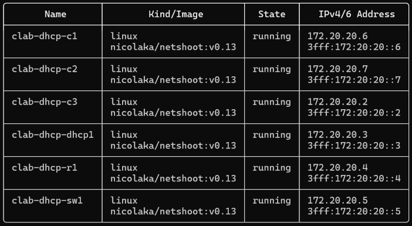
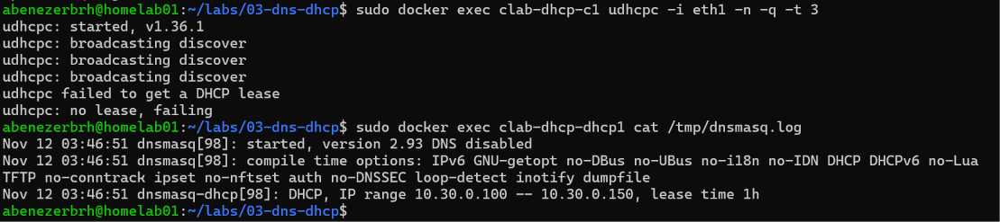
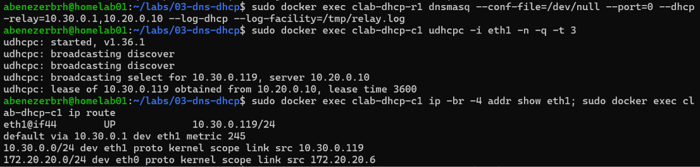
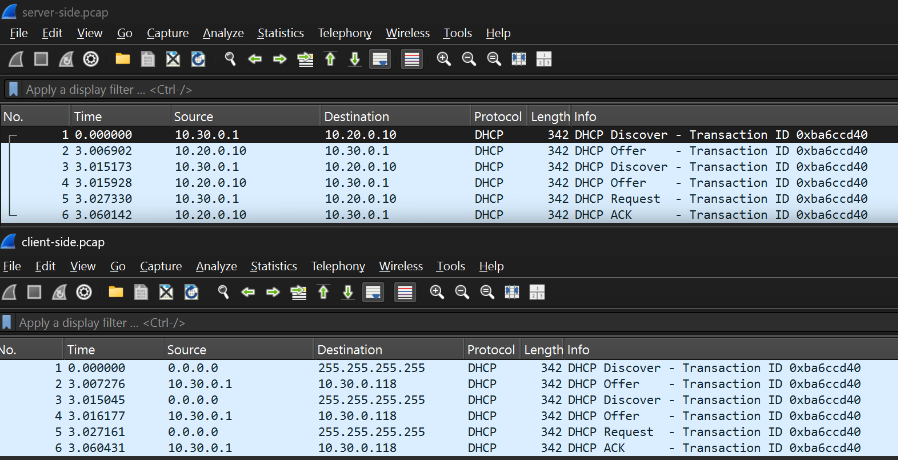
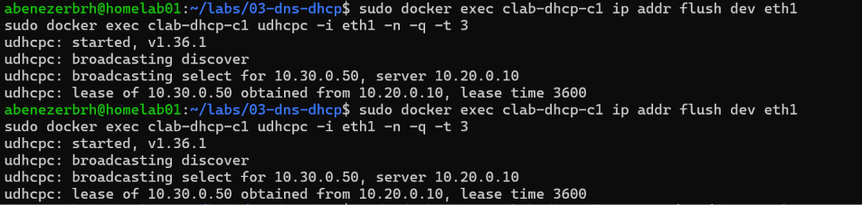

# Project 3 - Homelab DNS + DHCP Server

## Overview

This project focused on running my own name resolution and address assignment.

In the first part, I set up Unbound as a recursive DNS resolver behind Pi-hole, so homelab01 looks up DNS answers itself instead of relying on a public DNS provider. In the second part, I built an isolated lab to run a DHCP server and a DHCP relay, and tested what happens when DNS and DHCP fail.

---

## Scope

homelab01 is on a shared network that belongs to my landlord, so the project is split in two:

- **DNS (Part A)** runs on my real network but only affects my own devices, which are manually set to use Pi-hole.
- **DHCP (Part B)** runs only inside an isolated Containerlab lab. Running a second DHCP server on a shared network would hand out wrong settings to other people's devices (a "rogue DHCP server"), so it never touches the real network.

---

## Environment

| Item | Value |
|---|---|
| Host | `homelab01`, Dell OptiPlex 5060, Ubuntu Linux |
| DNS filter | Pi-hole |
| Recursive resolver | Unbound (`127.0.0.1#5335`) |
| DNS clients | My Windows laptop (DNS set to `192.168.1.78`) |
| DHCP lab | Containerlab (Part B) |

---

## Architecture

**Screenshot 1**


---

# Part A: DNS

## 1. Current Pi-hole Setup

### Commands

```bash
pihole status; pihole -v
```

```bash
sudo pihole-FTL --config dns.upstreams
```

### Observations

- Pi-hole was running, on Core 6.5, Web 6.6.1, and FTL 6.8, all up to date.
- The upstream DNS servers were Cloudflare's `1.1.1.1` and `1.0.0.1`. I noted these as a rollback in case Unbound didn't work.

**Screenshot 2**


---

## 2. Installing Unbound

### Command

```bash
sudo apt update && sudo apt install unbound
```

### Observations

- Unbound installed along with three libraries: libevent (handles many network connections efficiently), libhiredis (optional Redis cache support), and libprotobuf-c (optional dnstap logging).
- The installer enabled Unbound to start at boot, but failed to start it right away ("Could not execute systemctl"). Unbound's default config tries to use port 53, which Pi-hole already uses.
- The installer also enabled `unbound-resolvconf`, a helper that would make Unbound homelab01's own DNS server. I disabled it in section 4 to keep the router as homelab01's DNS server.

---

## 3. Configuring Unbound

Created `/etc/unbound/unbound.conf.d/pi-hole.conf`:

```
server:
    verbosity: 0
    interface: 127.0.0.1
    port: 5335
    do-ip4: yes
    do-udp: yes
    do-tcp: yes
    do-ip6: no
    prefer-ip6: no
    harden-glue: yes
    harden-dnssec-stripped: yes
    use-caps-for-id: no
    edns-buffer-size: 1232
    prefetch: yes
    num-threads: 1
    private-address: 192.168.0.0/16
    private-address: 169.254.0.0/16
    private-address: 172.16.0.0/12
    private-address: 10.0.0.0/8
    private-address: fd00::/8
    private-address: fe80::/10
```

### Key settings

- **`interface: 127.0.0.1` and `port: 5335`:** Unbound only listens on homelab01 itself, on port 5335. It doesn't compete with Pi-hole for port 53, and only Pi-hole can reach it.
- **`harden-dnssec-stripped`:** enforces DNSSEC validation, so tampered answers are rejected.
- **`prefetch`:** refreshes popular records before they expire, keeping lookups fast.
- **`private-address`:** blocks outside DNS servers from returning private IP addresses, which protects against DNS rebinding attacks.

---

## 4. Keeping homelab01's Own DNS Separate

### Commands

```bash
systemctl is-enabled unbound-resolvconf
sudo systemctl disable --now unbound-resolvconf
```

### Observations

Installing Unbound also enabled `unbound-resolvconf`, a helper service that makes Unbound the DNS server for homelab01 itself. `systemctl is-enabled` confirmed it was `enabled`, so I disabled it.

### What was learned

Pi-hole and Unbound answer DNS for my laptop, but homelab01 uses the router for its own lookups. If homelab01 depended on Unbound and Unbound broke, it couldn't resolve names at all, so I couldn't run `apt` or keep Tailscale working to fix it. Keeping the server I'm experimenting on independent from the experiment means it can always be repaired.

---

## 5. Testing Unbound

### Commands

```bash
dig pi-hole.net @127.0.0.1 -p 5335
```

```bash
dig fail01.dnssec.works @127.0.0.1 -p 5335
dig dnssec.works @127.0.0.1 -p 5335
```

### Observations (recursion and caching)

- The first query for `pi-hole.net` took **385 ms**. Unbound had to look it up from scratch, starting at the root DNS servers.
- The same query a few seconds later took **0 ms**, because Unbound answered from its cache.
- The TTL dropped from `3600` to `3580` between the two queries. A cached answer is only kept for its TTL (here, one hour), and the number shows how much time is left.
- `pi-hole.net` had no `ad` flag because the domain isn't DNSSEC-signed. Unsigned domains still resolve normally, just without being verified.

**Screenshot 3**


**Screenshot 4**


---

## 6. Pointing Pi-hole at Unbound

Replaced Pi-hole's upstream DNS servers with Unbound (`127.0.0.1#5335`) under **Settings → DNS** in the Pi-hole admin page.

### Observations

- Unticked all the preset upstream providers, including Cloudflare, and added `127.0.0.1#5335` as the only custom DNS server.
- Pi-hole's own hint text uses this exact format as its example for a local Unbound instance (`IP#port`).
- `pihole-FTL --config dns.upstreams` confirmed `127.0.0.1#5335` was the only upstream.
- Pi-hole's built-in DHCP server stays disabled, since enabling it would put a second DHCP server on the shared network.

**Screenshot 5**


---

## 7. Testing from the Laptop

### Command

```powershell
nslookup github.com 192.168.1.78
```

### Observations

- The lookup from my laptop returned an IP for github.com, with the server listed as `pi.hole` (192.168.1.78). The laptop's DNS path is now laptop → Pi-hole → Unbound.
- "Non-authoritative answer" means the answer came from a resolver, not from GitHub's own DNS servers.
- The same lookup from homelab01 earlier returned a different IP (140.82.114.4 vs 140.82.113.3). GitHub hands out different addresses to spread traffic across its servers.

**Screenshot 6**


---

## 8. Watching Recursive Resolution

### Commands

```bash
sudo systemctl restart unbound
sudo tcpdump -i wlp2s0 -nn -w recursion.pcap port 53 and not host 192.168.1.254 and not host 192.168.1.86
dig wikipedia.org @127.0.0.1 -p 5335
```

Restarting Unbound cleared its cache, so the lookup had to start from the root servers. The capture filter left out homelab01's own lookups to the router and my laptop's queries to Pi-hole.

### Observations

| Packets | Asked | Question | Reply |
|---|---|---|---|
| 1–2 | Root server (m.root-servers.net) | Who are the root servers? | List of all root servers (priming) |
| 3–4 | Root server (e.root-servers.net) | `org` | Referral to the `.org` servers |
| 5–6 | `.org` server | `wikipedia.org` | Referral to `ns0`/`ns1`/`ns2.wikimedia.org`, with glue IPs |
| 7–8 | ns0.wikimedia.org | `wikipedia.org` | Final answer: `208.80.153.224` |
| 9+ | Root and `.org` servers | `DNSKEY` | Signing keys for DNSSEC validation |

**Screenshot 7**


### What was learned

- **Each level only knows the next step.** The root servers don't know Wikipedia's IP. They point to `.org`, which points to Wikipedia's own servers, which give the answer.
- **QNAME minimisation:** Unbound only asked the root about `org`, not the full name, so each server learns only what it needs to.
- **Glue records:** the `.org` referral included the IP of Wikipedia's name servers, so Unbound didn't need a separate lookup to find them.
- **DNSSEC:** Unbound fetched the root and `.org` signing keys. The `.org` reply included signed proof (`NSEC3`) that wikipedia.org isn't DNSSEC-signed, so Unbound could confirm the answer was legitimately unsigned rather than tampered with.
- **The `_ta-` query** returned "no such name" on purpose. It tells root server operators which DNSSEC root key the resolver trusts.

## 9. Local DNS Records

I added local DNS records in Pi-hole so I can reach devices by name instead of by IP address.

I used the `.home.arpa` ending because it's officially reserved for home networks, so it will never clash with a real website. Made-up endings like `.lab` could become real domains someday, and `.local` is used by mDNS, which can cause conflicts.

### Records added

Added under **Settings → Local DNS Records** in the Pi-hole admin page:

| Type | Name | Points to |
|---|---|---|
| DNS (A) | `homelab01.home.arpa` | `192.168.1.78` |
| CNAME | `pihole.home.arpa` | `homelab01.home.arpa` |

The CNAME is an alias: `pihole.home.arpa` is another name for homelab01. If homelab01's IP changes, only the A record needs updating.

**Screenshot 8**


### Testing from the laptop

```powershell
nslookup homelab01.home.arpa
nslookup pihole.home.arpa
ssh abenezerbrh@homelab01.home.arpa
```

#### Observations

- At first, both lookups failed with "Non-existent domain," and SSH said "Could not resolve hostname." The server in the output was `Telus` (192.168.1.254), the router, which has never heard of my local names.
- My laptop's DNS was set to automatic on this network, so it used the router from DHCP. I had set Pi-hole as the DNS server before, but Windows 11 saves DNS settings per Wi-Fi network, and that setting was for a different network.
- After setting this network's DNS to Pi-hole (192.168.1.78) manually, `nslookup pihole.home.arpa` returned `homelab01.home.arpa` at 192.168.1.78, with `pihole.home.arpa` listed as an alias. The CNAME worked.

### Problem: Local DNS names didn't resolve on the laptop

#### Cause

The laptop was asking the router for DNS, not Pi-hole. Its DNS setting for this Wi-Fi network was automatic, so it used the router handed out by DHCP. Local records only exist in Pi-hole, so the router replied that the names didn't exist.

#### Fix

Set the laptop's DNS for this network to Pi-hole (192.168.1.78) manually.

#### Verified

`nslookup` showed `Server: pi.hole`, and the local names resolved to 192.168.1.78.

**Screenshot 9**


### Testing from homelab01

```bash
dig homelab01.home.arpa
dig homelab01.home.arpa @127.0.0.1
```

#### Prediction

The first lookup would fail, because homelab01 uses the router for its own DNS, and the router doesn't know about my local records. The second would work, because it asks Pi-hole directly.

#### Observations

- `dig homelab01.home.arpa` was answered by the router (192.168.1.254) with `status: NXDOMAIN`, meaning the name doesn't exist as far as the router knows.
- `dig homelab01.home.arpa @127.0.0.1` was answered by Pi-hole with `status: NOERROR` and the address 192.168.1.78.
- Pi-hole's reply had the `aa` (authoritative) flag, since the record lives in Pi-hole itself, and a TTL of 0, so clients don't cache local records and see changes right away.

**Screenshot 10**


### What was learned

- Local DNS records only work for devices that actually ask Pi-hole. The router has no idea they exist.
- homelab01 can't see its own local name by default, because it uses the router for DNS. That's the tradeoff of keeping it independent from Pi-hole for safety.
- `dig`'s `SERVER` line shows which DNS server answered, which is the first thing to check when a name doesn't resolve.

---

## 10. Query Logging and Blocking

### Watching queries

```bash
pihole -t
```

#### Observations

- With my laptop away from home, the log was quiet. The only regular entries were hourly `PTR` lookups for `1.0.0.127.in-addr.arpa`.
- A PTR record is a reverse lookup: it turns an IP into a name, the opposite of an A record. Pi-hole does this every hour to keep client names up to date, and answered from `/etc/hosts` with `localhost`.
- `query[TXT] local.api.ftl` entries are internal checks from Pi-hole's web interface.

**Screenshot 11**


### Blocking from a blocklist

```bash
pihole -q doubleclick.net
```

```powershell
nslookup doubleclick.net
```

#### Observations

- `dig doubleclick.net @127.0.0.1` returned `0.0.0.0`.
- The log showed `gravity blocked doubleclick.net is 0.0.0.0`. "Gravity" is Pi-hole's database of domains from its downloaded blocklists.
- Pi-hole blocks by answering with `0.0.0.0`, an address that goes nowhere, so the ad never loads.

**Screenshot 12**


### Blocking a domain manually

Added `example.com` as a deny entry under **Domains**, tested it, then removed it.

#### Observations

- At first, I added `example.com` under **Lists** by mistake. Lists are for blocklist files (URLs), so Pi-hole tried to download it as a list and failed. I removed it, added it under **Domains** as an exact deny entry, and ran `pihole -g` to rebuild the blocklist database.
- After that, the log showed `exactly denied example.com is 0.0.0.0`. Pi-hole's log names which rule blocked each domain.
- After removing the deny entry, `example.com` resolved normally again.

**Screenshot 13**


### What was learned

- When I'm away from home, my laptop uses the DNS server of whatever network it's on, not Pi-hole. To test Pi-hole remotely, I sent queries from homelab01 itself with `dig <domain> @127.0.0.1`.
- Pi-hole blocked `doubleclick.net` because it's on one of its downloaded blocklists. It answered with `0.0.0.0`, so the ad never loads.
- To block a single domain myself, it has to be added under **Domains**, not **Lists**. Lists are for blocklist files that Pi-hole downloads.
- After adding `example.com` as a deny entry, Pi-hole blocked it. After removing the entry, it resolved normally again.
- Pi-hole's log shows why each domain was blocked: "gravity blocked" for blocklists, "exactly denied" for my own entries.

---

# Part B: DHCP

## 11. Lab Design

The DHCP lab runs entirely inside Containerlab, isolated from my home network, so a DHCP server can't hand out addresses to anyone else's devices.

**Screenshot 14**



### Addressing

| Device | Interface | IP address | Role |
|---|---|---|---|
| dhcp1 | eth1 | 10.20.0.10/24 | DHCP server (dnsmasq) |
| r1 | eth1 | 10.20.0.1/24 | Router, server side |
| r1 | eth2 | 10.30.0.1/24 | Router, client side, DHCP relay |
| sw1 | eth1 to eth4 | none | Switch connecting r1 and the clients |
| c1, c2, c3 | eth1 | from DHCP | Clients |

- **Server network:** 10.20.0.0/24
- **Client network:** 10.30.0.0/24, with a DHCP pool of 10.30.0.100 to 10.30.0.150

### Why a relay is needed

The clients and the DHCP server are on different networks. A DHCP Discover is a broadcast, and routers don't forward broadcasts, so without help the server never hears the clients.

The DHCP relay on r1 catches the broadcast and forwards it to the server as a normal packet. It also adds its own client-side address (10.30.0.1) to the request in a field called **giaddr** (gateway IP address). The server uses giaddr to know which network the client is on, and which pool to hand out an address from.

This is the Linux equivalent of Cisco's `ip helper-address`.

---

## 12. Checking the Tools

### Command

```bash
sudo docker run --rm nicolaka/netshoot:v0.13 sh -c "which udhcpc dnsmasq; ls /usr/share/udhcpc/"
```

### Observations

- `udhcpc`, a lightweight DHCP client, was already installed at `/sbin/udhcpc`.
- Its helper script, `default.script`, was in `/usr/share/udhcpc/`. `udhcpc` uses this script to actually apply the address, gateway, and other settings it receives. Without it, a client would get a lease but never configure its interface.
- `dnsmasq` was not installed (`which` printed nothing for it). Since dhcp1 needs it as the DHCP server and r1 needs it as the relay, the topology file installs it with `apk add --no-cache dnsmasq` when the lab starts. That runs before each container's default route is removed, since it needs internet access.
- `--rm` deleted the test container as soon as the check finished.

---

## 13. Deploying the Lab Without a Relay

### Prediction

c1 would not get an address. Its DHCP Discover is a broadcast, and r1 won't forward broadcasts to the server network.

### Observations

- dnsmasq was running on dhcp1, serving the range 10.30.0.100 to 10.30.0.150 with a 1-hour lease.
- c1 broadcast a DHCP Discover three times, then gave up with "no lease."
- dhcp1's log only showed its startup messages. It never received c1's requests.

The broadcasts stopped at r1. Routers separate broadcast domains, so the DHCP server on the other network never heard them.

**Screenshot 15**



---

## 14. Enabling the DHCP Relay

### Prediction

With the relay running on r1, c1's request would be forwarded to dhcp1, and c1 would get an address from the 10.30.0.100 to 10.30.0.150 pool.

### Observations

- After starting the relay, c1 got the address 10.30.0.119 from the server at 10.20.0.10, with a lease time of 3600 seconds (1 hour).
- `udhcpc` calls the Request step "select." c1 sent two Discovers before getting an offer. The first was likely sent while the relay was still starting.
- dnsmasq doesn't hand out addresses in order. It picks one based on the client's MAC address, so the same client tends to get the same address.
- `ip addr` and `ip route` confirmed c1 applied both the address (10.30.0.119/24) and the default gateway (10.30.0.1) it received through DHCP.
- `ping 10.20.0.10` from c1 worked with `ttl=63`, showing c1 could use its new address and gateway to reach a device across r1.
- The server's log showed the full exchange: `DHCPDISCOVER`, `DHCPOFFER`, `DHCPREQUEST`, `DHCPACK`.
- dhcp1 sits on 10.20.0.0/24 but handed out an address from the 10.30.0.0/24 pool. It knew which pool to use because the relay included its client-side address (10.30.0.1) in the request.
- The server also sent two renewal timers: **T1 (30 minutes)**, when the client asks the same server to renew, and **T2 (52.5 minutes)**, when it asks any server if the first renewal failed.


**Screenshot 16**



---

## 15. Capturing the Relayed DHCP Exchange

### Observations

I captured on both sides of r1 at the same time while c2 requested an address. c2 got 10.30.0.118.

| | Client side (r1 `eth2`) | Server side (r1 `eth1`) |
|---|---|---|
| Discover and Request | 0.0.0.0 → 255.255.255.255 (broadcast) | 10.30.0.1 → 10.20.0.10 (unicast) |
| Offer and ACK | 10.30.0.1 → 10.30.0.118 | 10.20.0.10 → 10.30.0.1 |

- The relay turned c2's broadcasts into unicast packets sent directly to the server.
- The server replied to the relay (10.30.0.1), not to the client. That's why dhcp1 needs a route back to the client network.
- Every packet in both captures had the same Transaction ID (`0xba6ccd40`). The relay keeps it unchanged, so the client, relay, and server can all match up the same exchange.
- The first Offer came 3 seconds after the first Discover. Before offering an address, dnsmasq pings it to make sure no other device is already using it, and waits for a reply. c2 timed out and sent a second Discover in the meantime.
- In the server-side packets, the **Relay agent IP address** (giaddr) was 10.30.0.1 and **Hops** was 1. On the client side, giaddr was 0.0.0.0 and Hops was 0.
- The relay is what adds giaddr and increases Hops. The server uses giaddr to know which network the client is on, so it can pick the right pool, and to know where to send its reply.

**Screenshot 17**



---

## 16. DHCP Reservations

A reservation tells the DHCP server to always give a specific device the same address, identified by its MAC address. It's how devices like printers and servers keep a fixed IP while still getting it through DHCP.

### Commands

Got c1's MAC address, then restarted dnsmasq on dhcp1 with a reservation added:

```bash
sudo docker exec clab-dhcp-c1 ip link show eth1
sudo docker exec clab-dhcp-dhcp1 pkill dnsmasq
sudo docker exec clab-dhcp-dhcp1 dnsmasq ... --dhcp-host=<C1-MAC>,10.30.0.50 ...
```

Then had c1 drop its address and request a new one, twice:

```bash
sudo docker exec clab-dhcp-c1 ip addr flush dev eth1
sudo docker exec clab-dhcp-c1 udhcpc -i eth1 -n -q -t 3
```

### Prediction

c1 would get 10.30.0.50 instead of an address from the pool.

### Observations

- c1 got 10.30.0.50 both times, the reserved address.
- I reserved an address outside the dynamic pool (.100 to .150), so reserved addresses can never clash with the ones handed out to other clients.
- Only one Discover was needed this time. The 3-second ping check from earlier was most likely skipped, since the server already knows which device the reserved address belongs to.
- c3, which has no reservation, got 10.30.0.116 from the pool. When it asked again, it got the same address with only one Discover, because the server already had an active lease for its MAC.
- The lease file listed all three clients: c1 at its reserved 10.30.0.50, c2 at 10.30.0.118, and c3 at 10.30.0.116. c1's old lease for .119 was removed once it took its reserved address.
- Each lease line shows the expiry time (as a Unix timestamp), the MAC address, the IP, the hostname (`*` when the client doesn't send one), and the client ID.


**Screenshot 18**



### Limitation

Containerlab gives containers new MAC addresses each time the lab is rebuilt, so this reservation stops matching after a redeploy. On a real network, a device's MAC stays the same, which is why reservations work reliably there.

---

### What was learned (Part B)

- **Routers block broadcasts.** Without a relay, c1's DHCP Discovers never reached the server on the other network.
- **A DHCP relay turns broadcasts into unicast.** r1 caught the client's broadcast and forwarded it directly to the server, then passed the server's reply back to the client.
- **giaddr tells the server where the client is.** The relay filled in its client-side address (10.30.0.1) and raised Hops from 0 to 1. The server used giaddr to pick the right pool and to know where to send its reply.
- **The server replies to the relay, not the client,** so it needs a route back to the client network.
- **The Transaction ID stays the same** across the whole exchange, on both sides of the relay, which ties the client, relay, and server conversations together.
- **dnsmasq pings an address before offering it,** to make sure no one else is using it. That caused a 3-second delay and a second Discover from new clients.
- **DHCP gives more than an IP.** Clients also got their subnet mask, default gateway, and renewal timers (T1 at half the lease, T2 at 87.5%).
- **Reservations tie an address to a MAC address.** c1 always got 10.30.0.50, while clients without a reservation got pool addresses. Clients without one still tend to keep the same address while their lease is active.

## Commands Reference

### Part A: DNS

**On homelab01:**

```bash
# Pi-hole
pihole status
pihole -v
pihole -t                                        # watch queries live
pihole -q <domain>                               # check if a domain is on a list
pihole -g                                        # rebuild the blocklist database
sudo pihole-FTL --config dns.upstreams           # show upstream DNS servers

# Unbound
sudo apt install unbound
sudo nano /etc/unbound/unbound.conf.d/pi-hole.conf
systemctl is-enabled unbound-resolvconf
sudo systemctl disable --now unbound-resolvconf
sudo systemctl restart unbound
systemctl status unbound --no-pager

# Testing
dig <domain> @127.0.0.1 -p 5335                  # ask Unbound directly
dig <domain> @127.0.0.1                          # ask Pi-hole directly
dig <domain>                                     # ask homelab01's own DNS (the router)
dig fail01.dnssec.works @127.0.0.1 -p 5335       # DNSSEC test, should SERVFAIL

# Capturing recursive resolution
sudo tcpdump -i wlp2s0 -nn -w recursion.pcap port 53 and not host 192.168.1.254 and not host 192.168.1.86
```

**On the Windows laptop:**

```powershell
nslookup <domain>                                # ask the laptop's DNS server
nslookup <domain> 192.168.1.78                   # ask Pi-hole directly
Get-DnsClientServerAddress -AddressFamily IPv4   # show the laptop's DNS servers
```

### Part B: DHCP

**On homelab01:**

```bash
# Lab
sudo containerlab deploy -t topology.clab.yml
sudo containerlab destroy -t topology.clab.yml

# DHCP server (dhcp1)
sudo docker exec clab-dhcp-dhcp1 ps aux | grep dnsmasq
sudo docker exec clab-dhcp-dhcp1 cat /tmp/dnsmasq.log
sudo docker exec clab-dhcp-dhcp1 cat /tmp/dnsmasq.leases
sudo docker exec clab-dhcp-dhcp1 pkill dnsmasq

# DHCP relay (r1)
sudo docker exec clab-dhcp-r1 dnsmasq --conf-file=/dev/null --port=0 --dhcp-relay=10.30.0.1,10.20.0.10 --log-dhcp --log-facility=/tmp/relay.log

# Clients
sudo docker exec clab-dhcp-<client> udhcpc -i eth1 -n -q -t 3
sudo docker exec clab-dhcp-<client> ip addr flush dev eth1
sudo docker exec clab-dhcp-<client> ip -br -4 addr show eth1
sudo docker exec clab-dhcp-<client> ip route
sudo docker exec clab-dhcp-<client> ip link show eth1

# Capturing on both sides of the relay
sudo docker exec -d clab-dhcp-r1 tcpdump -i eth2 -nn -w /tmp/client-side.pcap port 67 or port 68
sudo docker exec -d clab-dhcp-r1 tcpdump -i eth1 -nn -w /tmp/server-side.pcap port 67 or port 68
sudo docker exec clab-dhcp-r1 pkill tcpdump
sudo docker cp clab-dhcp-r1:/tmp/client-side.pcap ~/
```

**On the Windows laptop:**

```powershell
scp abenezerbrh@192.168.1.78:~/<file>.pcap .
```

---

## Project Outcome

By the end of the project, I could:

- Run my own recursive DNS resolver (Unbound) behind Pi-hole, instead of relying on a public DNS provider
- Validate DNS answers with DNSSEC, and show it rejecting tampered records
- Trace a DNS lookup step by step, from the root servers down to a domain's own server
- Create local DNS names for my devices, and explain why they only work for clients that use Pi-hole
- Read Pi-hole's query log and block domains, both through blocklists and manually
- Build an isolated DHCP lab with a server, a relay, a switch, and multiple clients
- Explain why DHCP needs a relay across routers, and show the giaddr and Hops fields the relay adds
- Set up DHCP reservations so a device always gets the same address

The biggest lesson was how much both services depend on **which server a client is actually asking**. My local DNS names failed on my laptop because it was quietly using the router instead of Pi-hole, and DHCP requests never reached the server until a relay carried them across the router. Most DNS and DHCP problems come down to the same question: where is the request really going?