# Project 3 - Homelab DNS + DHCP Server

## Overview

This project focused on running my own name resolution and address assignment.

In the first part, I set up Unbound as a recursive DNS resolver behind Pi-hole, so homelab01 looks up DNS answers itself instead of relying on a public DNS provider. In the second part, I built an isolated lab to run a DHCP server and a DHCP relay, and tested what happens when DNS and DHCP fail.

---

## Scope

homelab01 is on a shared network that belongs to my landlord, so the project is split in two:

- **DNS (Part A)** runs on my real network but only affects my own devices, which are manually set to use Pi-hole.
- **DHCP (Part B)** runs only inside an isolated Containerlab lab. Running a second DHCP server on a shared network would hand out wrong settings to other people's devices (a "rogue DHCP server"), so it never touches the real network.

---

## Environment

| Item | Value |
|---|---|
| Host | `homelab01`, Dell OptiPlex 5060, Ubuntu Linux |
| DNS filter | Pi-hole |
| Recursive resolver | Unbound (`127.0.0.1#5335`) |
| DNS clients | My Windows laptop (DNS set to `192.168.1.78`) |
| DHCP lab | Containerlab (Part B) |

---

## Architecture

**Screenshot 1**

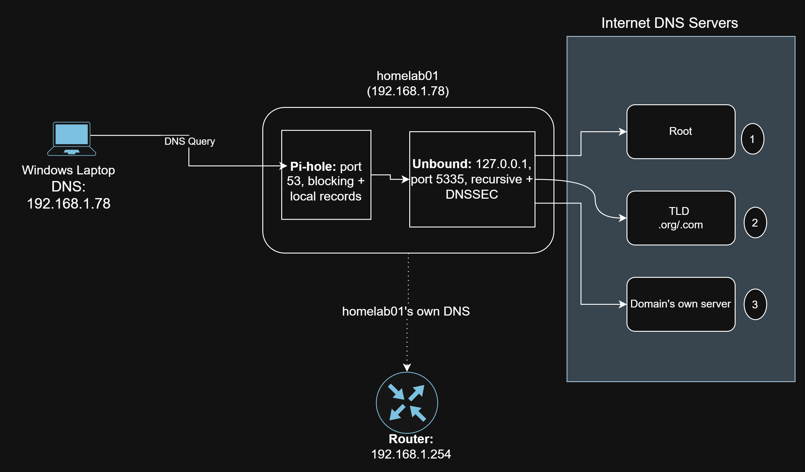

---

# Part A: DNS

## 1. Current Pi-hole Setup

### Commands

```bash
pihole status; pihole -v
```

```bash
sudo pihole-FTL --config dns.upstreams
```

### Observations

- Pi-hole was running, on Core 6.5, Web 6.6.1, and FTL 6.8, all up to date.
- The upstream DNS servers were Cloudflare's `1.1.1.1` and `1.0.0.1`. I noted these as a rollback in case Unbound didn't work.

**Screenshot 2**

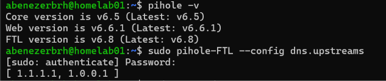

---

## 2. Installing Unbound

### Command

```bash
sudo apt update && sudo apt install unbound
```

### Observations

- Unbound installed along with three libraries: libevent (handles many network connections efficiently), libhiredis (optional Redis cache support), and libprotobuf-c (optional dnstap logging).
- The installer enabled Unbound to start at boot, but failed to start it right away ("Could not execute systemctl"). Unbound's default config tries to use port 53, which Pi-hole already uses.
- The installer also enabled `unbound-resolvconf`, a helper that would make Unbound homelab01's own DNS server. I disabled it in section 4 to keep the router as homelab01's DNS server.

---

## 3. Configuring Unbound

Created `/etc/unbound/unbound.conf.d/pi-hole.conf`:

```
server:
    verbosity: 0
    interface: 127.0.0.1
    port: 5335
    do-ip4: yes
    do-udp: yes
    do-tcp: yes
    do-ip6: no
    prefer-ip6: no
    harden-glue: yes
    harden-dnssec-stripped: yes
    use-caps-for-id: no
    edns-buffer-size: 1232
    prefetch: yes
    num-threads: 1
    private-address: 192.168.0.0/16
    private-address: 169.254.0.0/16
    private-address: 172.16.0.0/12
    private-address: 10.0.0.0/8
    private-address: fd00::/8
    private-address: fe80::/10
```

### Key settings

- **`interface: 127.0.0.1` and `port: 5335`:** Unbound only listens on homelab01 itself, on port 5335. It doesn't compete with Pi-hole for port 53, and only Pi-hole can reach it.
- **`harden-dnssec-stripped`:** enforces DNSSEC validation, so tampered answers are rejected.
- **`prefetch`:** refreshes popular records before they expire, keeping lookups fast.
- **`private-address`:** blocks outside DNS servers from returning private IP addresses, which protects against DNS rebinding attacks.

---

## 4. Keeping homelab01's Own DNS Separate

### Commands

```bash
systemctl is-enabled unbound-resolvconf
sudo systemctl disable --now unbound-resolvconf
```

### Observations

Installing Unbound also enabled `unbound-resolvconf`, a helper service that makes Unbound the DNS server for homelab01 itself. `systemctl is-enabled` confirmed it was `enabled`, so I disabled it.

### What was learned

Pi-hole and Unbound answer DNS for my laptop, but homelab01 uses the router for its own lookups. If homelab01 depended on Unbound and Unbound broke, it couldn't resolve names at all, so I couldn't run `apt` or keep Tailscale working to fix it. Keeping the server I'm experimenting on independent from the experiment means it can always be repaired.

---

## 5. Testing Unbound

### Commands

```bash
dig pi-hole.net @127.0.0.1 -p 5335
```

```bash
dig fail01.dnssec.works @127.0.0.1 -p 5335
dig dnssec.works @127.0.0.1 -p 5335
```

### Observations (recursion and caching)

- The first query for `pi-hole.net` took **385 ms**. Unbound had to look it up from scratch, starting at the root DNS servers.
- The same query a few seconds later took **0 ms**, because Unbound answered from its cache.
- The TTL dropped from `3600` to `3580` between the two queries. A cached answer is only kept for its TTL (here, one hour), and the number shows how much time is left.
- `pi-hole.net` had no `ad` flag because the domain isn't DNSSEC-signed. Unsigned domains still resolve normally, just without being verified.

**Screenshot 3**

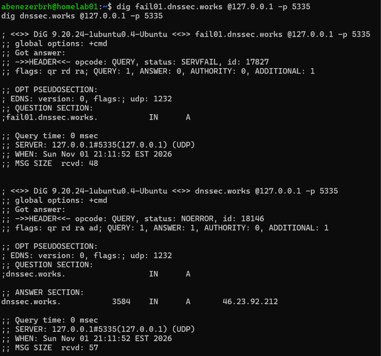

**Screenshot 4**


---

## 6. Pointing Pi-hole at Unbound

Replaced Pi-hole's upstream DNS servers with Unbound (`127.0.0.1#5335`) under **Settings → DNS** in the Pi-hole admin page.

### Observations

- Unticked all the preset upstream providers, including Cloudflare, and added `127.0.0.1#5335` as the only custom DNS server.
- Pi-hole's own hint text uses this exact format as its example for a local Unbound instance (`IP#port`).
- `pihole-FTL --config dns.upstreams` confirmed `127.0.0.1#5335` was the only upstream.
- Pi-hole's built-in DHCP server stays disabled, since enabling it would put a second DHCP server on the shared network.

**Screenshot 5**

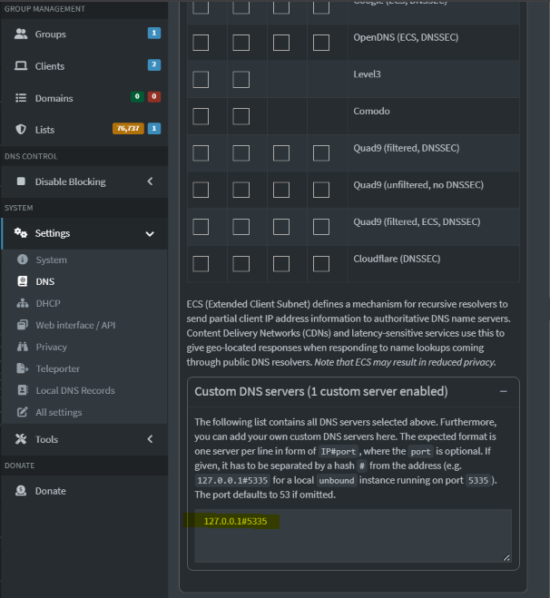

---

## 7. Testing from the Laptop

### Command

```powershell
nslookup github.com 192.168.1.78
```

### Observations

- The lookup from my laptop returned an IP for github.com, with the server listed as `pi.hole` (192.168.1.78). The laptop's DNS path is now laptop → Pi-hole → Unbound.
- "Non-authoritative answer" means the answer came from a resolver, not from GitHub's own DNS servers.
- The same lookup from homelab01 earlier returned a different IP (140.82.114.4 vs 140.82.113.3). GitHub hands out different addresses to spread traffic across its servers.

**Screenshot 6**

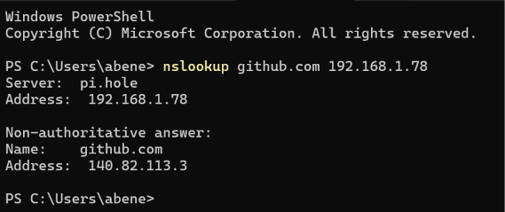

---

## 8. Watching Recursive Resolution

### Commands

```bash
sudo systemctl restart unbound
sudo tcpdump -i wlp2s0 -nn -w recursion.pcap port 53 and not host 192.168.1.254 and not host 192.168.1.86
dig wikipedia.org @127.0.0.1 -p 5335
```

Restarting Unbound cleared its cache, so the lookup had to start from the root servers. The capture filter left out homelab01's own lookups to the router and my laptop's queries to Pi-hole.

### Observations

| Packets | Asked | Question | Reply |
|---|---|---|---|
| 1–2 | Root server (m.root-servers.net) | Who are the root servers? | List of all root servers (priming) |
| 3–4 | Root server (e.root-servers.net) | `org` | Referral to the `.org` servers |
| 5–6 | `.org` server | `wikipedia.org` | Referral to `ns0`/`ns1`/`ns2.wikimedia.org`, with glue IPs |
| 7–8 | ns0.wikimedia.org | `wikipedia.org` | Final answer: `208.80.153.224` |
| 9+ | Root and `.org` servers | `DNSKEY` | Signing keys for DNSSEC validation |

**Screenshot 7**

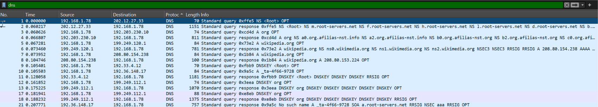

### What was learned

- **Each level only knows the next step.** The root servers don't know Wikipedia's IP. They point to `.org`, which points to Wikipedia's own servers, which give the answer.
- **QNAME minimisation:** Unbound only asked the root about `org`, not the full name, so each server learns only what it needs to.
- **Glue records:** the `.org` referral included the IP of Wikipedia's name servers, so Unbound didn't need a separate lookup to find them.
- **DNSSEC:** Unbound fetched the root and `.org` signing keys. The `.org` reply included signed proof (`NSEC3`) that wikipedia.org isn't DNSSEC-signed, so Unbound could confirm the answer was legitimately unsigned rather than tampered with.
- **The `_ta-` query** returned "no such name" on purpose. It tells root server operators which DNSSEC root key the resolver trusts.

## 9. Local DNS Records

I added local DNS records in Pi-hole so I can reach devices by name instead of by IP address.

I used the `.home.arpa` ending because it's officially reserved for home networks, so it will never clash with a real website. Made-up endings like `.lab` could become real domains someday, and `.local` is used by mDNS, which can cause conflicts.

### Records added

Added under **Settings → Local DNS Records** in the Pi-hole admin page:

| Type | Name | Points to |
|---|---|---|
| DNS (A) | `homelab01.home.arpa` | `192.168.1.78` |
| CNAME | `pihole.home.arpa` | `homelab01.home.arpa` |

The CNAME is an alias: `pihole.home.arpa` is another name for homelab01. If homelab01's IP changes, only the A record needs updating.

**Screenshot 8**

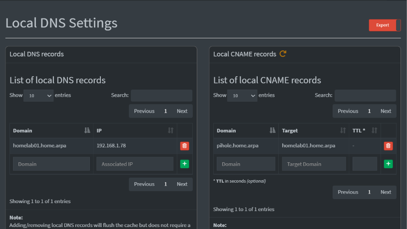

### Testing from the laptop

```powershell
nslookup homelab01.home.arpa
nslookup pihole.home.arpa
ssh abenezerbrh@homelab01.home.arpa
```

#### Observations

- At first, both lookups failed with "Non-existent domain," and SSH said "Could not resolve hostname." The server in the output was `Telus` (192.168.1.254), the router, which has never heard of my local names.
- My laptop's DNS was set to automatic on this network, so it used the router from DHCP. I had set Pi-hole as the DNS server before, but Windows 11 saves DNS settings per Wi-Fi network, and that setting was for a different network.
- After setting this network's DNS to Pi-hole (192.168.1.78) manually, `nslookup pihole.home.arpa` returned `homelab01.home.arpa` at 192.168.1.78, with `pihole.home.arpa` listed as an alias. The CNAME worked.

### Problem: Local DNS names didn't resolve on the laptop

#### Cause

The laptop was asking the router for DNS, not Pi-hole. Its DNS setting for this Wi-Fi network was automatic, so it used the router handed out by DHCP. Local records only exist in Pi-hole, so the router replied that the names didn't exist.

#### Fix

Set the laptop's DNS for this network to Pi-hole (192.168.1.78) manually.

#### Verified

`nslookup` showed `Server: pi.hole`, and the local names resolved to 192.168.1.78.

**Screenshot 9**

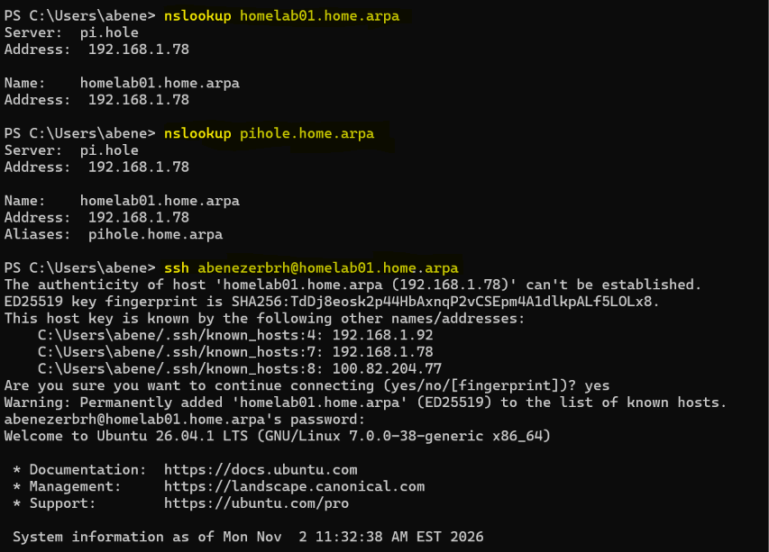

### Testing from homelab01

```bash
dig homelab01.home.arpa
dig homelab01.home.arpa @127.0.0.1
```

#### Prediction

The first lookup would fail, because homelab01 uses the router for its own DNS, and the router doesn't know about my local records. The second would work, because it asks Pi-hole directly.

#### Observations

- `dig homelab01.home.arpa` was answered by the router (192.168.1.254) with `status: NXDOMAIN`, meaning the name doesn't exist as far as the router knows.
- `dig homelab01.home.arpa @127.0.0.1` was answered by Pi-hole with `status: NOERROR` and the address 192.168.1.78.
- Pi-hole's reply had the `aa` (authoritative) flag, since the record lives in Pi-hole itself, and a TTL of 0, so clients don't cache local records and see changes right away.

**Screenshot 10**

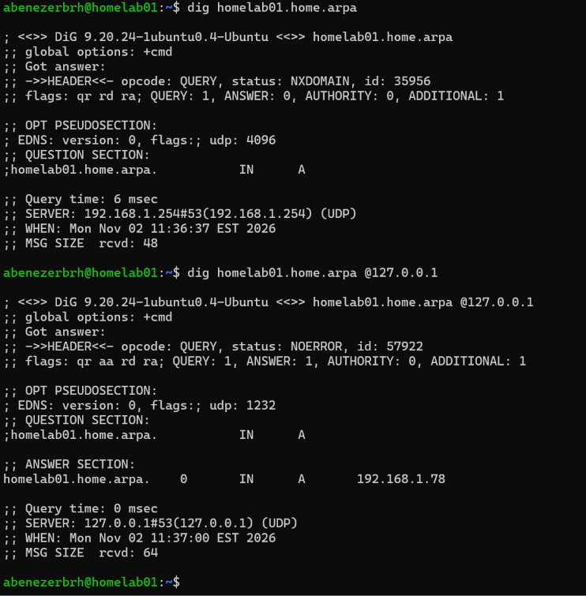

### What was learned

- Local DNS records only work for devices that actually ask Pi-hole. The router has no idea they exist.
- homelab01 can't see its own local name by default, because it uses the router for DNS. That's the tradeoff of keeping it independent from Pi-hole for safety.
- `dig`'s `SERVER` line shows which DNS server answered, which is the first thing to check when a name doesn't resolve.

---

## 10. Query Logging and Blocking

### Watching queries

```bash
pihole -t
```

#### Observations

_To be added_

**Screenshot 11**

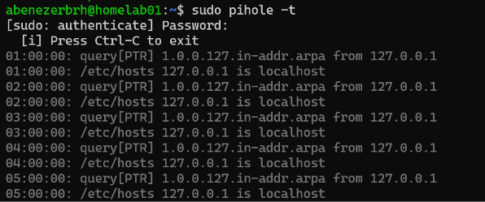

### Blocking from a blocklist

```bash
pihole -q doubleclick.net
```

```powershell
nslookup doubleclick.net
```

#### Observations

_To be added_

**Screenshot 12**

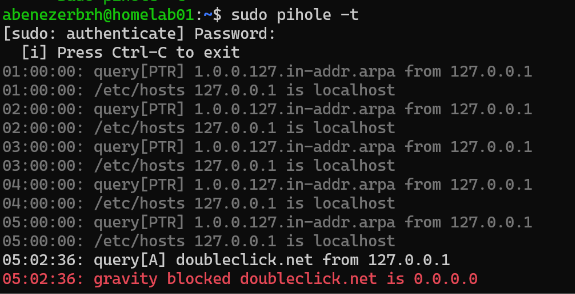

### Blocking a domain manually

Added `example.com` as a deny entry under **Domains**, tested it, then removed it.

#### Observations

_To be added_

**Screenshot 13**

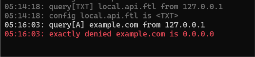

### What was learned

_To be added_

---

# Part B: DHCP

_To be added_

---

## Problems Encountered

_To be added_

---

## Break and Fix Tests

_To be added_

---

## Key Concepts Learned

_To be added_

---

## Commands Reference

_To be added_

---

## Project Outcome

_To be added_