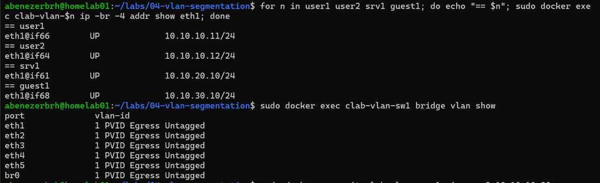
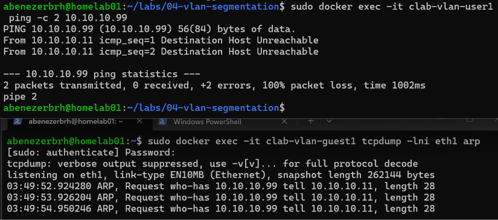
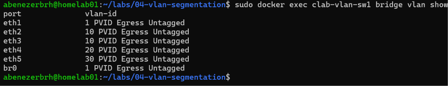
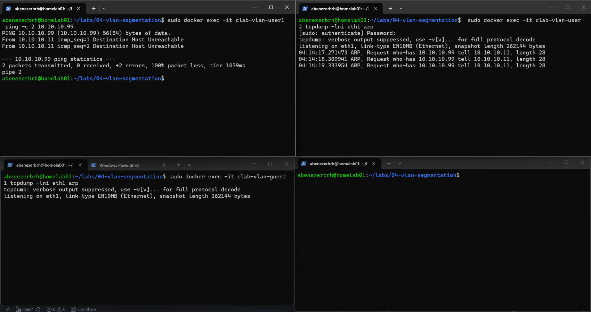
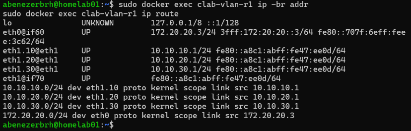

# Project 4 - VLAN Segmented Network

## Overview

This project focused on splitting one physical network into several isolated networks using VLANs, then controlling what's allowed to talk between them.

I built a small office-style network in Containerlab with three VLANs on a single switch, connected the switch to a router with a trunk, set up routing between the VLANs, and added firewall rules to restrict traffic. Then I broke it on purpose to practice troubleshooting.

---

## Scope

The entire lab runs inside homelab01 as containers, isolated from my home network. No physical switch was needed.

---

## Environment

| Item | Value |
|---|---|
| Host | `homelab01`, Dell OptiPlex 5060, Ubuntu Linux |
| Lab tool | Containerlab (with Docker) |
| Node image | `nicolaka/netshoot:v0.13` |
| Switch | Linux bridge with VLAN filtering |
| Router | Linux container with VLAN subinterfaces |
| Firewall | nftables |
| Topology file | [`topology.clab.yml`](topology.clab.yml) |

---

## Topology

**Screenshot 1**

### VLAN plan

| VLAN | Name | Network | Gateway (r1) | Purpose |
|---|---|---|---|---|
| 10 | Users | 10.10.10.0/24 | 10.10.10.1 | Staff devices |
| 20 | Servers | 10.10.20.0/24 | 10.10.20.1 | Internal servers |
| 30 | Guest | 10.10.30.0/24 | 10.10.30.1 | Visitor devices |

### Addressing

| Device | VLAN | IP address | Connects to |
|---|---|---|---|
| user1 | 10 | _To be added_ | sw1 |
| user2 | 10 | _To be added_ | sw1 |
| srv1 | 20 | _To be added_ | sw1 |
| guest1 | 30 | _To be added_ | sw1 |
| r1 | 10, 20, 30 | 10.10.10.1, 10.10.20.1, 10.10.30.1 | sw1 (trunk) |

---

## 1. Key Concepts

### VLANs

A VLAN (Virtual LAN) splits one physical switch into several separate networks. Devices in different VLANs can't talk to each other directly, even when they're plugged into the same switch. Each VLAN is its own broadcast domain.

### Access ports vs trunk ports

- **Access port:** belongs to one VLAN. Used for end devices like computers and servers.
- **Trunk port:** carries traffic for several VLANs over a single link. Used between switches, or between a switch and a router.

### 802.1Q tagging

On a trunk, each frame gets a small 4-byte tag that says which VLAN it belongs to. The switch adds the tag when a frame enters the trunk and removes it before delivering the frame to an access port, so end devices never see it.

### Native VLAN

The native VLAN is the one VLAN that travels **untagged** on a trunk. Both ends of a trunk must agree on it, or traffic ends up in the wrong VLAN.

### Inter-VLAN routing

Since VLANs are separate networks, traffic between them has to go through a router. In a "router on a stick" setup, the router connects to the switch with one trunk link and uses a **subinterface** for each VLAN (like `eth1.10`), each acting as that VLAN's default gateway.

---

## 2. The Topology File

_To be added_

---

## 3. Deploying and Verifying the Lab

### Commands

_To be added_

### Observations

_To be added_

**Screenshot 2**

---

## 4. Configuring VLANs on the Switch

### Commands

_To be added_

### Observations

_To be added_

**Screenshot 3**

---

## 5. Testing VLAN Isolation

### Prediction

_To be added_

### Observations

_To be added_

**Screenshot 4**

---

## 6. Setting Up the Trunk and Router Subinterfaces

### Commands

_To be added_

### Observations

_To be added_

**Screenshot 5**

---

## 7. Inter-VLAN Routing

### Prediction

_To be added_

### Observations

_To be added_

**Screenshot 6**

---

## 8. Capturing 802.1Q Tags

### Commands

_To be added_

### Observations

_To be added_

**Screenshot 7**

