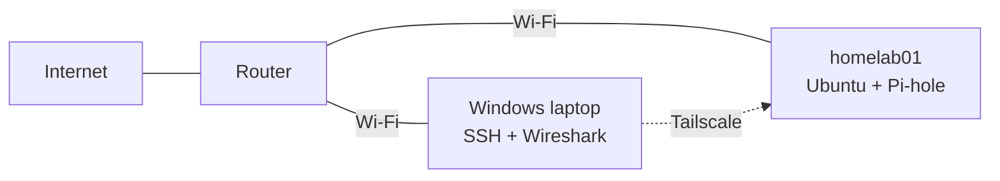

# Homelab

Hands-on networking projects built on a Dell OptiPlex 5060 (`homelab01`) running Ubuntu, managed from a Windows laptop.

I'm a Software Engineering student learning networking by building, capturing, and breaking things on purpose. Each project documents what I set up, what I observed at the packet level, what I broke, and how I diagnosed and fixed it.

---

## Projects

| # | Project | Focus | Status |
|---|---|---|---|
| 1 | [Network Discovery & Documentation](01-network-discovery/) | IP addressing, DHCP, ARP, DNS, packet capture, break/fix testing | Complete |
| 2 | Build a Small Routed Network | Routing, static routes, failure testing | Planned |
| 3 | Homelab DNS + DHCP Server | Pi-hole, DHCP, internal records, logging | Planned |
| 4 | VLAN Segmented Network | 802.1Q VLANs, trunks, inter-VLAN routing, ACLs | Planned |
| 5 | Network Monitoring System | SNMP, Prometheus, Grafana | Planned |
| 6 | VPN Remote Access Lab | WireGuard, split/full tunnels, firewall segmentation | Planned |
| 7 | Network Security Gateway | OPNsense/pfSense, NAT, IDS/IPS, DMZ | Planned |
| 8 | Automated Network Configuration | Python, Ansible, Git-based config backups | Planned |
| 9 | Highly Available Enterprise Network | OSPF, HSRP/VRRP, STP, LACP (simulated) | Planned |
| 10 | Mini Enterprise Network | Multi-VLAN design, dual ISP, automation, post-mortems | Planned |

---

## Lab Setup

| Component | Details |
|---|---|
| Server | `homelab01`, Dell OptiPlex 5060, Ubuntu Linux |
| Connection | Wi-Fi (`wlp2s0`), Ethernet port (`eno1`) available for later projects |
| Workstation | Windows laptop for SSH and Wireshark |
| Services | Pi-hole (DNS) |
| Remote access | Tailscale VPN |
| Tools | tcpdump, Wireshark, dig, resolvectl, iproute2 (`ip`), nmap |



**Constraint:** the lab currently sits on a shared network I don't manage, so I keep testing limited to my own devices and use Tailscale for remote access instead of port forwarding. Later projects will move to a network I control.

---

## Approach

Every project follows the same pattern:

1. **Build** the setup and record the baseline
2. **Observe** what's happening with packet captures and command output
3. **Break** something on purpose
4. **Diagnose** it from the symptoms: symptom, diagnosis, root cause, fix, verification
5. **Document** it, including mistakes

---

## Repository Structure

```text
homelab/
├── README.md
└── 01-network-discovery/
    ├── README.md        # project write-up
    └── screenshots/     # terminal and Wireshark screenshots (MACs hidden)
```

Packet capture files (`.pcap`) are kept out of the repo, and MAC addresses are hidden or replaced in screenshots and write-ups.